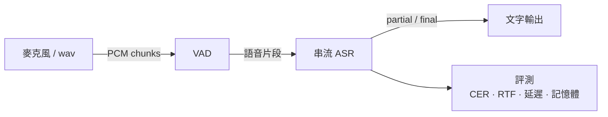

# ondevice-zh-asr

在 Apple 設備上實現**離線、低延遲的端側中文串流語音辨識**全鏈路：麥克風 / wav → VAD → 串流 ASR → 文字輸出 → 評測。

- 完全離線，不依賴雲端服務
- 串流輸出 partial 結果，以首字延遲為核心優化目標
- 所有結論都附可複現的量化指標（CER、RTF、首字延遲、峰值記憶體、模型大小）

> 🚧 開發中，目前處於第一階段。

## 架構

<!-- TODO: 實作完成後替換為實際架構圖 -->



## 快速開始

需求：Apple Silicon Mac、[uv](https://docs.astral.sh/uv/)。

```bash
git clone <repo-url> && cd ondevice-zh-asr
uv sync                                   # 安裝依賴（uv 會自動下載 Python 3.11）
uv run scripts/check_env.py               # 檢查環境：套件版本、ONNX Runtime providers、麥克風
bash scripts/download_models.sh           # 下載模型到 models/（含 SHA-256 校驗）
uv run pytest                             # 跑測試
uv run scripts/demo_vad.py [input.wav]    # VAD：印出語音段時間（--stream 看串流事件）
uv run scripts/demo_asr.py [input.wav]    # 串流 ASR：模擬即時逐 chunk 送入，印出 partial / 最終結果
                                          # --model x-asr-480ms-int8（預設）| zipformer-zh-14m
uv run scripts/run_pipeline.py [input.wav] -o out.json  # VAD + ASR：每句文字與時間戳（JSON）
uv run scripts/prepare_eval_data.py       # 下載並抽樣評測集：AISHELL-1 test 200 句（固定 seed，含 SHA-256 校驗）
uv run eval/run_eval.py                   # 全鏈路評測：CER / RTF / 首字延遲 / 峰值記憶體 / 模型大小 / 切段數
```

`check_env.py` 最後一行印出 `OK` 就代表環境可用；只要有任何一項失敗，它會以非零狀態碼結束。預期看到的 ONNX Runtime providers 有 `CoreMLExecutionProvider` 和 `CPUExecutionProvider`。

已驗證的環境：Apple M5 / macOS 27.0.1 / Python 3.11.15 / onnxruntime 1.31.1 / sherpa-onnx 2.0.1。

```bash
# TODO：以下命令尚未實作
uv run scripts/transcribe.py input.wav    # 辨識單一 wav
uv run scripts/mic_demo.py                # 麥克風即時辨識
```

## 指標

評測集：AISHELL-1 test 隨機 200 句（seed 20261030，17.2 分鐘）　|　Apple M5 / macOS 27.0.1　|　commit `f576d57`
CPU、單執行緒、10 ms chunk 模擬即時；VAD 為 Silero v6.2.3（threshold 0.5、min_speech 250 ms、pad 30 ms）。

**預設設定**（min_silence 500 ms、pre-roll 100 ms）

| 模型 | CER (%) | RTF | 首字延遲 mean / P90 (ms) | 尾字延遲 mean (ms)* | 每條切段數 | 峰值記憶體 (MB) | 模型大小 (MB) |
|---|---|---|---|---|---|---|---|
| **X-ASR 480 ms**（INT8，預設） | **5.07** | 0.036 | 990 / 1029 | 449 | 1.19 | 533 | 163.6 |
| zipformer-zh-14M（FP32） | 15.27 | 0.015 | 679 / 956 | 411 | 1.19 | 247 | 55.3 |

**VAD / pre-roll 掃描**：CER (%)，首字延遲 mean / P90 (ms)

| min_silence | pre-roll | X-ASR CER | X-ASR 首字 | zh-14M CER | zh-14M 首字 | 每條切段數 |
|---|---|---|---|---|---|---|
| 100 | 100 | 6.90 | 981 / 1029 | 17.91 | 674 / 956 | 1.74 |
| 300 | 100 | 5.47 | 992 / 1029 | 17.01 | 678 / 956 | 1.42 |
| **500** | **100** | **5.07** | **990 / 1029** | 15.27 | 679 / 956 | 1.19 |
| 800 | 100 | 4.83 | 994 / 1029 | 15.31 | 679 / 958 | 1.07 |
| 500 | 0 | 5.87 | 1046 / 1129 | 19.14 | 830 / 1372 | 1.19 |
| 500 | 200 | 5.04 | 953 / 976 | 14.80 | 656 / 860 | 1.19 |
| 500 | 300 | 5.00 | 907 / 1305 | 13.47 | 664 / 760 | 1.19 |

完整 4 × 4 掃描、成對 bootstrap 信賴區間與取捨分析見 [docs/progress.md](docs/progress.md)；指標定義與文字正規化規則見 [docs/eval.md](docs/eval.md)。

\* AISHELL 句尾靜音短（中位數約 410 ms），min_silence 500 ms 以上時尾字延遲被音訊結束截斷，即時輸入時約為 min_silence + 40 ms。

## 專案結構

```
src/vad/       語音活動偵測
src/asr/       串流語音辨識
src/pipeline/  串接音訊輸入、VAD、ASR
eval/          評測（CER / RTF / 延遲 / 記憶體）
scripts/       一條命令可執行的入口腳本
tests/         單元測試
docs/          設計與實驗紀錄
models/ data/  模型與資料（不進版控）
```

## 路線圖

**第一階段：VAD + 串流 ASR + 評測**
- [x] 模型下載腳本（含 checksum 校驗）
- [x] VAD 模組
- [x] 串流 ASR 模組
- [x] pipeline：wav 輸入（VAD + 串流 ASR，每句時間戳）
- [ ] pipeline：麥克風輸入
- [x] 評測：CER、RTF、首字延遲、峰值記憶體、模型大小、VAD 切段數
- [x] 基準指標寫入 README
- [x] VAD `min_silence_ms` / pre-roll 參數掃描

**第二階段：量化與 Core ML**
- [ ] INT8 / FP16 量化與精度對比
- [ ] Core ML 轉換，CPU / GPU / ANE 對比

**第三階段：iOS demo**
- [ ] Swift + Core ML 即時辨識 app
- [ ] 裝置端指標量測

## License

TBD
