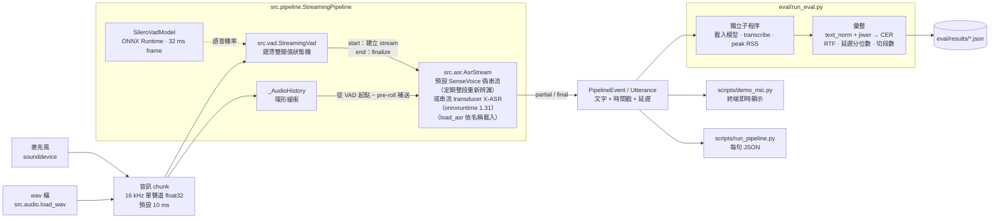
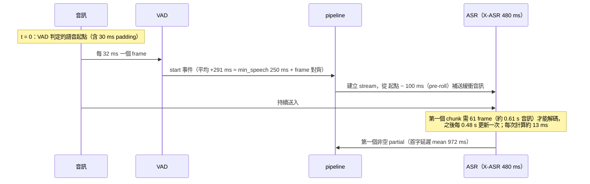
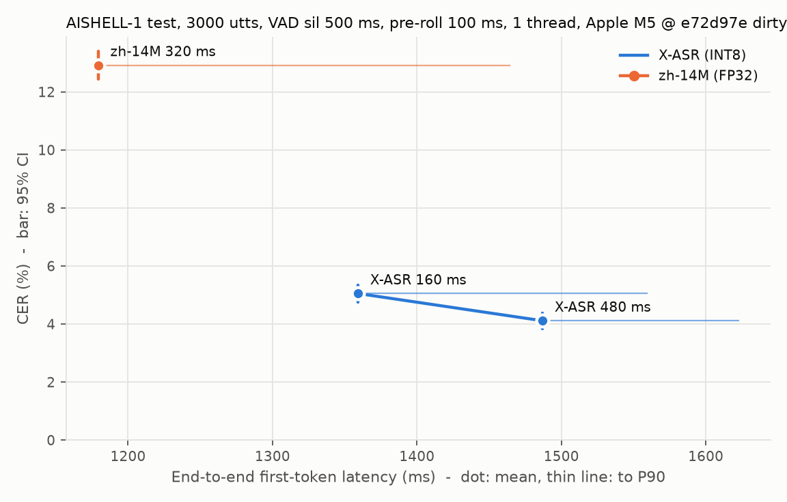

# ondevice-zh-asr

在 Apple 設備上實現**離線、低延遲的端側中文串流語音辨識**全鏈路：麥克風 / wav → VAD → 串流 ASR → 文字輸出 → 評測。

- 完全離線，不依賴雲端服務
- 串流輸出 partial 結果，以首字延遲為核心優化目標
- 所有結論都附可複現的量化指標（CER、RTF、首字延遲、峰值記憶體、模型大小）

> 🚧 第一階段（VAD + 串流 ASR + 評測框架）與延遲優化已完成，預設模型為 SenseVoice Small 偽串流（首字約 400 ms、說完到定稿約 680 ms，200 句冒煙集）。量化精度對比暫緩，下一步是**端側適配**：在 Mac app、iPhone、Android 上實際跑起來，見[路線圖](#路線圖)。

## 架構



設計重點（細節見 [docs/progress.md](docs/progress.md)）：

- **VAD 與 ASR 都是「逐 chunk 送入 → 回傳 partial / final」**，後端只依賴 `FrameClassifier` / `StreamingAsr` 介面，之後換成 Core ML 只換模型包裝。
- **離線與串流共用同一個狀態機**（離線 = 整段送入後 flush），兩者結果必然一致，有測試保證。
- **時間戳用「模擬即時」虛擬時鐘**：chunk 的最後一個樣本到達時刻 + 實際量測的計算時間，不真的 sleep；計算比音訊慢時會自然積壓。

首字延遲的組成（X-ASR 480 ms，2026-11-02 前的預設模型）：



VAD 確認的 291 ms 被「等第一個 chunk 收滿」蓋住（pre-roll 的音訊會一次補送），換更快的推論後端幫助不大。換成 160 ms chunk 也只快約 130 ms：VAD 發出 start 事件後，模型平均還要 554 ms 才輸出第一個字，瓶頸在模型多晚出字，不在 VAD（見 [docs/progress.md](docs/progress.md) 2026-10-31）。

預設的 SenseVoice 偽串流沒有「等 chunk 收滿」與模型輸出延遲的問題：VAD 發出 start 事件、補送 pre-roll 後，累積滿 0.48 s 音訊就整段辨識一次，200 句冒煙集的首字延遲（VAD 起點）mean 400 ms，比 X-ASR 快約 600 ms。代價是之後每 0.96 s 整段重算一次，partial 文字跳動較多；累積超過 3 s 就不再更新 partial，等暫定結果或定稿（車艙指令多在 3 s 內）。

## 快速開始

需求：Apple Silicon Mac、[uv](https://docs.astral.sh/uv/)、網路（第一次下載模型與評測資料）。
**所有 `uv run` 都要在 `ondevice-zh-asr/` 目錄內執行**，在外層執行會用到別的 Python 而缺套件。

```bash
git clone <repo-url> && cd ondevice-zh-asr   # repo 尚未公開，<repo-url> 待補
uv sync                                   # 安裝依賴（uv 會自動下載 Python 3.11）
uv run scripts/check_env.py               # 檢查環境：最後一行應為 OK
bash scripts/download_models.sh           # 下載模型到 models/（5 個模型，解壓後約 640 MB，含 SHA-256 校驗，可重複執行）
uv run pytest                             # 應為 202 passed、0 skipped（未建置 C++ 時 tests/test_cpp.py 的 2 項會跳過；建置後 204 passed）
```

`check_env.py` 列出套件版本、ONNX Runtime providers（應有 `CoreMLExecutionProvider` 與 `CPUExecutionProvider`）與麥克風；任何一項失敗都會以非零狀態碼結束。
沒有下載模型時 pytest 不會失敗，但用到真實模型的測試會被跳過（`-rs` 可看原因）；看到 skipped 代表模型沒裝好。

試用（不給 wav 時用內附的測試音訊；wav 需為 16 kHz）：

```bash
uv run scripts/demo_vad.py [input.wav]    # VAD：印出語音段時間（--stream 看串流事件）
uv run scripts/demo_asr.py [input.wav]    # 串流 ASR：模擬即時逐 chunk 送入，印出 partial / 最終結果
                                          # --model sensevoice-small-int8-ort-p480-960-max3-zh（預設）| x-asr-480ms-int8-ort | zipformer-zh-14m
uv run scripts/run_pipeline.py [input.wav] -o out.json  # VAD + ASR：每句文字與時間戳（JSON）
uv run scripts/demo_mic.py                # 麥克風即時辨識，Ctrl+C 結束並印出首字延遲統計
```

預設的結束判定是兩段門檻（方案 A2）：句中靜音 150 ms 先 finalize 出暫定結果（標「（暫定）」），靜音滿 700 ms 才定稿（2026-11-03 起，原為 1000 ms，針對車艙短指令）；暫定結果之後若又開始說話，會重新解碼整句並修正。上面三個腳本與 `eval/run_eval.py` 都可用 `--min-silence-ms 500 --pause-ms 0` 退回舊的單一門檻 500 ms。

第一次跑 `demo_mic.py` 時 macOS 會詢問麥克風權限；若曾拒絕，腳本會提示到「系統設定 → 隱私權與安全性 → 麥克風」開啟。

C++ 辨識核心（`cpp/`，第二階段的三平台共用核心；需要 cmake 與 onnxruntime C++ 預編譯包，路徑用 `-DORT_ROOT` 指定）：

```bash
cmake -S cpp -B cpp/build -DORT_ROOT=$PWD/third_party/onnxruntime-osx-arm64-1.31.1
cmake --build cpp/build -j
ctest --test-dir cpp/build --output-on-failure           # C++ 單元測試（fbank / VAD 狀態機 / CTC / pipeline / C API）
cpp/build/ozasr_cli --models-dir models tests/fixtures/vad_two_utterances.wav   # 每個檔案輸出一行 JSON 事件
uv run scripts/compare_cpp.py             # 與 Python 版對齊：fixture + 200 句冒煙集（約 2 分鐘）
uv run scripts/compare_fbank.py           # fbank / LFR 與 kaldi-native-fbank 的數值比對
```

C API 標頭在 `cpp/include/ozasr/ozasr_c_api.h`（Swift / Kotlin JNI 用）；設計與對齊結果見 [docs/progress.md](docs/progress.md)。沒建置 C++ 時，`tests/test_cpp.py` 會自動跳過。

評測：

```bash
uv run scripts/prepare_eval_data.py       # 下載並抽樣 AISHELL-1 test 3000 句（約 470 MB，固定 seed，逐檔 SHA-256 校驗）
uv run eval/run_eval.py                   # 預設設定（結束判定 A2），3000 句
uv run eval/run_eval.py --model x-asr-480ms-int8 zipformer-zh-14m --min-silence-ms 500 --pause-ms 0
                                          # 重現下方基準表（單一門檻 500 ms；X-ASR 約 9 分鐘、zh-14M 約 4 分鐘）

uv run scripts/prepare_eval_data.py -n 200   # 200 句冒煙子集（約 32 MB）
uv run eval/run_eval.py --smoke           # 改動後快速確認沒有改壞，每個模型約 1 分鐘
```

多值參數做掃描、`--limit` 除錯等用法見 [docs/eval.md](docs/eval.md)，所有腳本都有 `--help`。

已驗證的環境：Apple M5 / macOS 27.0.1 / Python 3.11.15 / onnxruntime 1.31.1 / sherpa-onnx 2.0.1。

## 基準指標

**目前預設**（2026-11-03）：SenseVoice Small INT8 偽串流（`sensevoice-small-int8-ort-p480-960-max3-zh`，語言固定中文、2 執行緒）＋ 結束判定 A2（句中停頓 150 ms 出暫定結果、靜音 700 ms 定稿）。200 句冒煙集，Apple M5（Mac17,3）/ macOS 27.0.1，量測時 load average 約 2：

| 指標 | 數值 |
|---|---|
| CER [95% CI] | 3.80% [2.80, 4.89] |
| 首字延遲（VAD 起點）mean / P90 | 400 / 404 ms |
| 端到端首字延遲 mean / P90 | 909 / 966 ms |
| 尾字延遲 mean（VAD 語音終點 → 定稿） | 678 ms |
| 每條切段數 mean（max） | 1.09（3） |
| RTF（牆鐘） | 0.032 |
| 峰值 RSS / 模型大小 | 446 MB / 230.7 MB（約 234M 參數，INT8；含 VAD 與 tokens） |

定稿門檻 1000 → 700 ms：在 ≤ 3 s 的 100 句短句子集上 CER 都是 2.49%、沒有句子被切開，尾字延遲 998 → 678 ms；冒煙集的 4–5 s 朗讀長句較常被切開，CER 3.43 → 3.80%（+0.37 個百分點，顯著）。以上只在 AISHELL-1 小集合上驗證，3000 句正式集尚未以目前預設重跑，泛化風險見 [docs/limitations.md](docs/limitations.md)；決定紀錄見 [docs/progress.md](docs/progress.md) 2026-11-02、2026-11-03。

### 歷史紀錄：X-ASR 時期的基準

**結束判定：方案 A2 對單一門檻**（X-ASR 480 ms；A2 當時為 pause 150 ms / min_silence 1000 ms，2026-11-01 起 pause 由 200 改為 150，2026-11-03 起 min_silence 改為 700），相對下表的單一門檻 500 ms。下表 A2 欄是 pause 200 時量的；改為 150 後，300 句對齊集的結果延遲再降約 55 ms，0.2 s 句間停頓後的句子從約 1.3 s 降到約 230 ms，先出半句暫定結果的句子 36% → 40%，CER 不變（見 [docs/scoreboard.md](docs/scoreboard.md)）：

| | 單一門檻 500 ms（舊預設） | **A2** |
|---|---|---|
| CER，3000 句 | 4.11% | **3.75%**（成對差 −0.36 個百分點，95% CI [−0.46, −0.26]） |
| 說完 → 完整結果（真實末字結束起算，300 句對齊集，mean / P50 / P90 ms） | 580 / 581 / 651 | **299 / 295 / 366** |
| 連續多句集：停頓 0.3 / 0.5 s 後的句子（mean ms） | 5806 / 2256（兩句被合併） | **約 290** |
| 先出半句暫定結果、之後被修正的句子 | — | 35% |
| RTF（300 句對齊集） | 0.027 | 0.033 |

A2 的數字出自 commit `b311a49` + `8e9b618` 的程式（3000 句以 `--jobs 4` 只看 CER）；改為預設後在 200 句冒煙集、300 句對齊集與連續多句集上重跑，最終文字與暫定結果逐句相同。各方案比較見 [docs/scoreboard.md](docs/scoreboard.md)，決定紀錄見 [docs/progress.md](docs/progress.md) 2026-11-01。

下表各模型的完整指標是在**單一門檻 500 ms** 下量的（2026-10-31，改預設前），用來比較模型；首字延遲與結束判定無關。

評測集：AISHELL-1 test 隨機 3000 句（seed 20261030，佔 test set 42%，251.2 分鐘，20 位說話人）　|　Apple M5（Mac17,3）/ macOS 27.0.1　|　commit `43282fe` + 本次提交的程式（2026-10-31）
CPU、單執行緒、10 ms chunk 模擬即時、暖機 3 句、每條前補 1 秒、後補 1.5 秒靜音；VAD 為 Silero v6.2.3（threshold 0.5、min_speech 250 ms、min_silence 500 ms、pad 30 ms）、pre-roll 100 ms。

| 模型 | 精度 | CER (%) | CER 95% CI（以句） | RTF§ | 端到端首字延遲 mean / P50 / P90 / P99 (ms)¶ | 首字延遲（VAD 起點）mean / P90 (ms) | 其中 VAD 觸發 (ms) | 尾字延遲 mean (ms)* | 每條切段數 | 峰值 RSS (MB)† | 模型大小 (MB) |
|---|---|---|---|---|---|---|---|---|---|---|---|
| **X-ASR 480 ms**（2026-11-02 前的預設）‡ | encoder / joiner INT8，decoder FP32 | **4.11** | [3.84, 4.38] | 0.026 | 1487 / 1533 / 1623 / 2073 | 972 / 1030 | 291 | 531 | 1.19 | 626 | 163.6 |
| X-ASR 160 ms‡ | 同上 | 5.05 | [4.76, 5.34] | 0.055 | 1359 / 1369 / 1559 / 1780 | 845 / 1023 | 291 | 604 | 1.19 | 639 | 163.6 |
| zipformer-zh-14M（320 ms） | FP32 | 12.92 | [12.44, 13.41] | 0.011 | 1179 / 1144 / 1464 / 1844 | 666 / 958 | 291 | 494 | 1.19 | 335 | 55.3 |



- X-ASR 160 ms 對 480 ms（同一批句子成對比較）：CER +0.94 個百分點（95% CI [0.77, 1.11]，顯著），端到端首字延遲平均 −128 ms，RTF 2.2 倍。預設維持 480 ms。
- 模型大小含 VAD（2.3 MB）與 tokens。X-ASR 約 0.16B（官方 README 比較表）；zh-14M 約 14M、Silero VAD 約 2M。
- 以說話人重抽的 CER 信賴區間與上一版基準（未補靜音，commit `982ca41`：X-ASR 4.15%、zh-14M 13.49%）見 [docs/progress.md](docs/progress.md)。
- CER 信賴區間是 95% 百分位 bootstrap（10000 次）：「以句」重抽句子，「以說話人」重抽 20 位說話人（較寬，接近換一批說話人的不確定性）。定義見 [docs/eval.md](docs/eval.md)。比較兩個設定時用同一批句子做成對 bootstrap，見 [docs/progress.md](docs/progress.md)。
- 上一版基準（200 句子集）：X-ASR 5.07%（95% CI [4.04, 6.18]）、zh-14M 15.27%（[13.34, 17.35]），都包含 3000 句的值，兩者沒有矛盾，差距在 200 句的抽樣誤差內。
- RTF 同設定重跑相差約 5%；辨識結果、CER、首字延遲、切段數可逐位重現，尾字延遲含實測計算時間，重跑差幾 ms。

§ RTF 的分母含前補 1 秒與後補 1.5 秒的靜音（VAD 判定為靜音的部分不送 ASR），因此比上一版（只含前補，X-ASR 480 ms 0.030）低，兩版不能直接比較。
¶ 端到端首字延遲的起點是補靜音結束點，含原始音訊開頭未標註的靜音，絕對值高估實際感受到的延遲，只適合設定之間比較；首字延遲（VAD 起點）以 VAD 判定的語音起點為起點。定義見 [docs/eval.md](docs/eval.md)。
\* 尾字延遲：VAD 語音終點（含 30 ms pad）→ 最終結果，≈ min_silence + 30–100 ms。上一版沒有後補靜音，句子多由音訊結束收尾，量到的值被截斷（X-ASR 480 ms 為 451 ms）。以 MFA 真實末字結束點起算，X-ASR 480 ms 為 580 ms（P90 651，300 句對齊集）。結束判定各設定的比較見 [docs/scoreboard.md](docs/scoreboard.md)。
† 峰值 RSS 隨評測句數增加（200 句時 X-ASR 531、zh-14M 252 MB），增加的部分來自評測 / pipeline 端，不是模型推論（單獨解碼 100 → 1000 句只增加約 3 MB），原因待查，見 [backlog B11](docs/backlog.md)。不同評測集之間的峰值 RSS 不要直接比較。
預設後端自 2026-11-01 起改為 onnxruntime 1.31.1 直接推論（`x-asr-480ms-int8-ort`），辨識結果與 sherpa-onnx 版逐句相同（200 句冒煙集），表中的 CER 與延遲不變；峰值 RSS 在 200 句冒煙集上 541 → 353 MB，3000 句未重跑。見 [docs/progress.md](docs/progress.md)。

### 預設模型的選擇：SenseVoice 偽串流對 X-ASR（2026-11-02）

**2026-11-02 起預設模型改為 SenseVoice Small 偽串流**（`sensevoice-small-int8-ort-p480-960-max3-zh`：非串流 CTC 模型，語言固定中文，第一次在累積 0.48 s 時整段辨識出 partial，之後每 0.96 s 一次，累積超過 3 s 不再更新、等暫定結果 / 定稿；**預設 2 執行緒**，X-ASR 等其他模型維持 1，`--threads` 可覆寫）。X-ASR 保留為 `x-asr-480ms-int8-ort`。200 句冒煙集（A2，當時 min_silence 1000 ms，量測時 load average 約 2.5–3）：

| | SenseVoice 偽串流（預設：zh、2 執行緒） | SenseVoice（auto、1 執行緒） | X-ASR 480 ms（1 執行緒） |
|---|---|---|---|
| CER [95% CI] | **3.43** [2.53, 4.41] | **3.40** [2.50, 4.37] | 4.80 [3.76, 5.93] |
| 首字延遲（VAD 起點）mean / P90 (ms) | **400 / 403** | 405 / 409 | 1006 / 1029 |
| 端到端首字延遲 mean / P90 (ms) | **909 / 966** | 915 / 971 | 1515 / 1623 |
| 停頓時產生暫定結果 mean / P90 (ms) | **70 / 101** | 112 / 166 | — |
| RTF | **0.033** | 0.051 | **0.032** |
| 峰值 RSS (MB) / 模型 (MB) | 441 / 230.7 | 443 / 230.7 | **358 / 163.6** |

語言固定 zh 讓第一個 partial 的英文碎片從 15–32% 降到 0–1.5%（CER 不變）；2 執行緒讓說完 → 完整結果快 30–50 ms、辨識結果逐句不變，CPU 時間多約 23%。RTF 為牆鐘時間，多執行緒時不等於 CPU 用量。

代價（見 [docs/progress.md](docs/progress.md) 2026-11-02「決定：預設改為 SenseVoice 偽串流」）：partial 每次整段重新辨識，畫面文字跳動比 X-ASR 多（語言固定 zh 後仍是約 2–5 倍）；記憶體與 CPU 用量較高；SenseVoice 權重採 FunASR Model License，商用依據目前只有維護者在 issue 中的回覆（[docs/models.md](docs/models.md)），正式商用前需書面確認。上方 3000 句的模型比較表未含 SenseVoice。
‡ X-ASR 的訓練資料是否含 AISHELL-1 未知（見 [docs/models.md](docs/models.md)），這個 CER 不能當作跨領域泛化能力；zh-14M 依文件只用 WenetSpeech，對它是跨領域。

**VAD / pre-roll 掃描**（200 句子集，commit `f576d57`；選參數時的依據，數字與上表不同集）：CER (%)，首字延遲 mean / P90 (ms)

| min_silence | pre-roll | X-ASR CER | X-ASR 首字 | zh-14M CER | zh-14M 首字 | 每條切段數 |
|---|---|---|---|---|---|---|
| 100 | 100 | 6.90 | 981 / 1029 | 17.91 | 674 / 956 | 1.74 |
| 300 | 100 | 5.47 | 992 / 1029 | 17.01 | 678 / 956 | 1.42 |
| **500** | **100** | **5.07** | **990 / 1029** | 15.27 | 679 / 956 | 1.19 |
| 800 | 100 | 4.83 | 994 / 1029 | 15.31 | 679 / 958 | 1.07 |
| 500 | 0 | 5.87 | 1046 / 1129 | 19.14 | 830 / 1372 | 1.19 |
| 500 | 200 | 5.04 | 953 / 976 | 14.80 | 656 / 860 | 1.19 |
| 500 | 300 | 5.00 | 907 / 1305 | 13.47 | 664 / 760 | 1.19 |

完整 4 × 4 掃描、信賴區間與取捨分析見 [docs/progress.md](docs/progress.md)；指標定義與文字正規化規則見 [docs/eval.md](docs/eval.md)。

## 已知限制

**泛化性**：所有優化與預設參數都只在 AISHELL-1 小集合（200 / 300 句、朗讀語音）上驗證，與車艙的自然口語指令差距很大；各項優化的泛化風險與之後要做的驗證見 [docs/limitations.md](docs/limitations.md)。風險最高的是定稿門檻 700 ms（口語的猶豫停頓可能被誤切）。

**評測方法**

- **延遲是模擬即時**：假設音訊準時到達、沒有其他程序搶 CPU，不含音訊驅動的緩衝延遲。麥克風路徑（`demo_mic.py`）能印出牆鐘延遲，但尚未與模擬值做正式對比。
- **還沒有真實語音起點**：端到端首字延遲不依賴 VAD，但含原始音訊開頭未標註的靜音，只能做相對比較；以 VAD 起點的首字延遲則受 VAD 切點影響（VAD 切得晚時反而「看起來較好」）。
- **評測集太乾淨**：AISHELL-1 是安靜環境的單句朗讀，沒有長靜音與背景噪音，VAD 的誤觸發沒有被量到。連續多句的斷句另有合成集（300 句串成 77 條，句間停頓 0.2–2 s，見 [docs/eval.md](docs/eval.md)），但停頓長度是人為分檔、也沒有噪音。
- **不是完整 test set**：3000 句佔 7176 句的 42%，論文的 AISHELL-1 CER 通常用完整集，不能逐位對照；VAD / pre-roll 掃描只在 200 句子集上做過。音訊來自第三方鏡像 `shenyunhang/AISHELL-1`，無法對官方 checksum 驗證。
- **說話人只有 20 位**：以說話人重抽的 CER 信賴區間比以句重抽寬約 2 倍（X-ASR）到 3.6 倍（zh-14M）。
- 多執行緒只量過 SenseVoice 的 2 執行緒（RTF 為牆鐘時間，CPU 用量多約 23%）。

**模型**

- **X-ASR 的訓練資料不明**：官方只說「約 100 萬小時開源及收集語音」，沒有資料集清單，是否含 AISHELL-1 train / test 未知；因此 4.15% 無法判定是跨領域、同領域還是有資料洩漏。授權已確認為 Apache-2.0。細節與來源見 [docs/models.md](docs/models.md)。
- **SenseVoice 的訓練資料與授權**：訓練資料同樣沒有公開完整清單，可能含 AISHELL；權重採 FunASR Model License，商用依據目前只有維護者在 issue 中的回覆，正式商用前需書面確認（[docs/models.md](docs/models.md)）。
- **沒有 FP32 / FP16 精度對比**：SenseVoice 與 X-ASR 都直接用官方 INT8 權重；量化精度對比暫緩（2026-11-03 決定），INT8 相對 FP32 的精度損失未量。
- zh-14M 依 sherpa-onnx 文件只用 WenetSpeech 訓練，在 AISHELL-1 上是跨領域，CER 偏高。

**系統**

- **X-ASR 的首字延遲約 1 秒**（VAD 起點），計算每個 chunk 約 13 ms，換 Core ML / ANE 無法改善。換 160 ms chunk 只快約 130 ms 且 CER 顯著變差：瓶頸是模型多晚輸出第一個字：字級對齊顯示模型在首字唸完約 190 ms 後才輸出它（見 [docs/latency-analysis.md](docs/latency-analysis.md)）。
- **結束判定用兩段門檻（A2）緩解，但沒有根治**：單一靜音門檻無法同時切對句中停頓與句間停頓（500 ms 時 15% 的單句音訊被切成多段；1000 ms 則短於門檻的句間停頓會讓兩句合併，前一句的最終結果要等下一句說完）。A2 在句中停頓時先給暫定結果、靜音滿門檻才定稿（本段數字是 X-ASR 時期以 200 / 1000 ms 量的；目前預設 150 / 700 ms），使用者約 300 ms 就看到結果，代價是 35% 的句子先出現半句暫定結果再被修正、RTF 0.027 → 0.033；短於 0.3 s 的句間停頓仍會被合併（停頓 0.2 s 的句子平均約 1.3 s 才看到完整結果）。早 finalize 偶爾漏句尾的字，CER 比不早 finalize 的方案 A 高 0.05 個百分點。見 [docs/scoreboard.md](docs/scoreboard.md)。
- **記憶體偏重**：X-ASR 載入後 RSS 比載入前多約 435 MB，遠大於模型檔 164 MB。關掉 ONNX Runtime 的 CPU memory arena 沒有效果（載入與峰值都在 ±1 MB 內），增加發生在載入階段而非推論；多出的部分是 sherpa-onnx 2.0.1 內附的 ONNX Runtime 1.28.2 在載入時留下約 180–190 MB 已釋放但未歸還的 malloc 記憶體（碎片），不是權重存了兩份；ORT 1.30.0 起沒有這個現象。預設已改用不經 sherpa-onnx 的 onnxruntime 1.31.1 後端，評測峰值 RSS 約少 190 MB、footprint 載入峰值 426 → 274 MB。見 [docs/progress.md](docs/progress.md)。
- **SenseVoice 偽串流的代價**：partial 每次整段重新辨識，文字跳動是 X-ASR 的 2–5 倍，每次計算量隨句長增加；超過 3 s 的句子之後只能等暫定結果或定稿。峰值 RSS 約 446 MB（200 句冒煙集），比 X-ASR 多約 90 MB。
- 目前只跑 CPU；只在 macOS（Apple M5）驗證過，還沒在 iPhone / iPad 上跑過。

完整清單與優先順序見 [docs/backlog.md](docs/backlog.md)。

## 專案結構

```
src/audio.py   取樣率與讀 wav（全專案共用）
src/paths.py   repo 與 models/ 目錄
src/cli.py     腳本共用的命令列參數
src/vad/       語音活動偵測（Silero VAD 狀態機）
src/asr/       語音辨識（介面 + SenseVoice 偽串流 / 串流 transducer 後端、CTC 熱詞解碼、模型註冊表）
src/pipeline/  串接音訊輸入、VAD、ASR
eval/          評測（CER / RTF / 延遲 / 記憶體）
scripts/       一條命令可執行的入口腳本
tests/         單元與整合測試（fixtures/ 是唯一放 wav 的地方）
docs/          設計與實驗紀錄（progress.md）、評測說明（eval.md）、問題與待辦（backlog.md）、泛化局限（limitations.md）
models/ data/  模型與資料（不進版控，由 scripts/ 下載並校驗）
```

## 路線圖

**第一階段：VAD + 串流 ASR + 評測** ✅
- [x] 模型下載腳本（含 checksum 校驗）
- [x] VAD 模組、串流 ASR 模組
- [x] pipeline：wav 輸入、麥克風輸入（每句時間戳；麥克風軟體路徑的實測延遲與模擬值差 < 25 ms）
- [x] 評測：CER、RTF、首字延遲、峰值記憶體、模型大小、VAD 切段數
- [x] VAD `min_silence_ms` / pre-roll 參數掃描，基準指標寫入 README

**延遲優化與模型選型** ✅（2026-10-31 ～ 11-03，數字見 [docs/progress.md](docs/progress.md)）
- [x] 推論後端：onnxruntime 1.31.1 直接推論（X-ASR 峰值 RSS 541 → 353 MB）、greedy search 批次 joiner
- [x] 結束判定 A2：句中停頓 150 ms 出暫定結果，靜音 700 ms 定稿
- [x] 模型比較：zipformer-zh-14M、X-ASR 160 / 480 ms、SenseVoice Small；預設改為 SenseVoice 偽串流（200 句：首字 1006 → 400 ms、CER 4.80 → 3.43%）
- [x] SenseVoice 調校：語言固定中文、partial 排程、2 執行緒、關掉執行緒空轉等待
- [x] SenseVoice 熱詞（CTC prefix beam search + Aho-Corasick，預設關閉）
- [x] 評測補強：MFA 真實語音起點（300 句對齊集）、連續多句合成集、partial 穩定度、麥克風路徑實測延遲

**下一步：端側適配**（目標：在 Mac app、iPhone、Android 三個平台上實際跑起來）

架構：辨識核心（音訊緩衝、Silero VAD 狀態機、A2 結束判定、SenseVoice 偽串流排程、CTC 解碼與熱詞）用 C++ 寫一次，推論用 onnxruntime（macOS / iOS / Android 都有官方預編譯版）；各平台只寫收音與介面（Swift / Kotlin），經 C API 呼叫核心。Python 版保留為參考實作與評測工具。

- [ ] C++ 核心：與 Python 版逐步對齊，以 `tests/fixtures` 的音訊確認 VAD 切點、partial / 暫定 / 定稿文字與 Python 版相同；提供 C API 給 Swift / Kotlin
- [ ] Mac app（SwiftUI）：AVAudioEngine 收音 → 核心 → 即時顯示 partial / 定稿；先在開發機上量延遲、RTF、記憶體，與 Python 模擬值對比
- [ ] iPhone app：共用 Mac 版的 Swift 程式碼，真機量測
- [ ] Android app（Kotlin + JNI）：AudioRecord 收音 → 核心，真機量測
- [ ] 平台加速（之後評估）：Apple 用 Core ML（SenseVoice 輸入長度可變，需固定或列舉輸入形狀；partial 最長 3 s 有助於限制形狀），Android 用 NNAPI / XNNPACK
- [ ] 完成標準：三個平台都能即時辨識車艙指令，各自的指標表（首字 / 尾字延遲、RTF、峰值記憶體、載入時間、App 大小）附機型與系統版本

**暫緩**
- 量化精度對比（FP32 / FP16 / 自行 INT8）：2026-11-03 決定暫緩，先用官方 INT8 權重
- 泛化驗證：3000 句正式集、自錄車艙口語指令、公開口語 / 車載語料（算力允許時，見 [docs/limitations.md](docs/limitations.md)）
- 噪音與垂直領域適配（真實車艙有 SSE 語音增強前端）、n-gram LM

## License

TBD。第三方模型與資料：X-ASR、zipformer-zh-14M 為 Apache-2.0，Silero VAD 為 MIT，AISHELL-1 為 Apache-2.0；本 repo 不散布模型權重與評測音訊，由 `scripts/` 從上游下載。來源與查證細節見 [docs/models.md](docs/models.md)。
