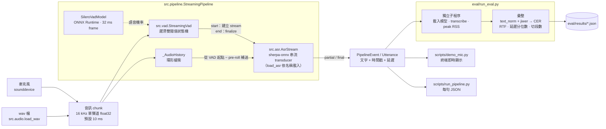

# ondevice-zh-asr

在 Apple 設備上實現**離線、低延遲的端側中文串流語音辨識**全鏈路：麥克風 / wav → VAD → 串流 ASR → 文字輸出 → 評測。

- 完全離線，不依賴雲端服務
- 串流輸出 partial 結果，以首字延遲為核心優化目標
- 所有結論都附可複現的量化指標（CER、RTF、首字延遲、峰值記憶體、模型大小）

> 🚧 第一階段（VAD + 串流 ASR + 評測框架）已完成，下一步見[路線圖](#路線圖)。

## 架構



設計重點（細節見 [docs/progress.md](docs/progress.md)）：

- **VAD 與 ASR 都是「逐 chunk 送入 → 回傳 partial / final」**，後端只依賴 `FrameClassifier` / `StreamingAsr` 介面，之後換成 Core ML 只換模型包裝。
- **離線與串流共用同一個狀態機**（離線 = 整段送入後 flush），兩者結果必然一致，有測試保證。
- **時間戳用「模擬即時」虛擬時鐘**：chunk 的最後一個樣本到達時刻 + 實際量測的計算時間，不真的 sleep；計算比音訊慢時會自然積壓。

首字延遲的組成（X-ASR 480 ms，預設設定）：


VAD 確認的 291 ms 被「等第一個 chunk 收滿」蓋住（pre-roll 的音訊會一次補送），因此首字延遲幾乎全是 ASR chunk 的演算法延遲，換更快的推論後端幫助不大。

## 快速開始

需求：Apple Silicon Mac、[uv](https://docs.astral.sh/uv/)、網路（第一次下載模型與評測資料）。
**所有 `uv run` 都要在 `ondevice-zh-asr/` 目錄內執行**，在外層執行會用到別的 Python 而缺套件。

```bash
git clone <repo-url> && cd ondevice-zh-asr   # repo 尚未公開，<repo-url> 待補
uv sync                                   # 安裝依賴（uv 會自動下載 Python 3.11）
uv run scripts/check_env.py               # 檢查環境：最後一行應為 OK
bash scripts/download_models.sh           # 下載模型到 models/（解壓後約 245 MB，含 SHA-256 校驗，可重複執行）
uv run pytest                             # 應為 84 passed、0 skipped
```

`check_env.py` 列出套件版本、ONNX Runtime providers（應有 `CoreMLExecutionProvider` 與 `CPUExecutionProvider`）與麥克風；任何一項失敗都會以非零狀態碼結束。
沒有下載模型時 pytest 不會失敗，但用到真實模型的 24 個測試會被跳過（`-rs` 可看原因）；看到 skipped 代表模型沒裝好。

試用（不給 wav 時用內附的測試音訊；wav 需為 16 kHz）：

```bash
uv run scripts/demo_vad.py [input.wav]    # VAD：印出語音段時間（--stream 看串流事件）
uv run scripts/demo_asr.py [input.wav]    # 串流 ASR：模擬即時逐 chunk 送入，印出 partial / 最終結果
                                          # --model x-asr-480ms-int8（預設）| zipformer-zh-14m
uv run scripts/run_pipeline.py [input.wav] -o out.json  # VAD + ASR：每句文字與時間戳（JSON）
uv run scripts/demo_mic.py                # 麥克風即時辨識，Ctrl+C 結束並印出首字延遲統計
```

第一次跑 `demo_mic.py` 時 macOS 會詢問麥克風權限；若曾拒絕，腳本會提示到「系統設定 → 隱私權與安全性 → 麥克風」開啟。

評測：

```bash
uv run scripts/prepare_eval_data.py       # 下載並抽樣 AISHELL-1 test 3000 句（約 470 MB，固定 seed，逐檔 SHA-256 校驗）
uv run eval/run_eval.py --model x-asr-480ms-int8 zipformer-zh-14m   # 重現下方基準表（X-ASR 約 9 分鐘、zh-14M 約 4 分鐘）

uv run scripts/prepare_eval_data.py -n 200   # 200 句冒煙子集（約 32 MB）
uv run eval/run_eval.py --smoke           # 改動後快速確認沒有改壞，每個模型約 1 分鐘
```

多值參數做掃描、`--limit` 除錯等用法見 [docs/eval.md](docs/eval.md)，所有腳本都有 `--help`。

已驗證的環境：Apple M5 / macOS 27.0.1 / Python 3.11.15 / onnxruntime 1.31.1 / sherpa-onnx 2.0.1。

## 基準指標

評測集：AISHELL-1 test 隨機 3000 句（seed 20261030，佔 test set 42%，251.2 分鐘，20 位說話人）　|　Apple M5（Mac17,3）/ macOS 27.0.1　|　commit `982ca41`
CPU、單執行緒、10 ms chunk 模擬即時、暖機 3 句；VAD 為 Silero v6.2.3（threshold 0.5、min_speech 250 ms、min_silence 500 ms、pad 30 ms）、pre-roll 100 ms。

| 模型 | 精度 | CER (%) | CER 95% CI（以句 / 以說話人） | RTF | 首字延遲 mean / P50 / P90 / P99 (ms) | 其中 VAD 觸發 (ms) | 尾字延遲 mean (ms)* | 每條切段數 | 峰值 RSS (MB)† | 模型大小 (MB) | 載入 (s) |
|---|---|---|---|---|---|---|---|---|---|---|---|
| **X-ASR 480 ms**（預設）‡ | encoder / joiner INT8，decoder FP32 | **4.15** | [3.89, 4.43] / [3.59, 4.75] | 0.036 | 961 / 1025 / 1029 / 1507 | 291 | 453 | 1.18 | 618 | 163.6 | 1.01 |
| zipformer-zh-14M | FP32 | 13.49 | [13.00, 13.99] / [11.68, 15.31] | 0.016 | 665 / 638 / 958 / 1596 | 291 | 417 | 1.18 | 333 | 55.3 | 0.26 |

- 模型大小含 VAD（2.3 MB）與 tokens。X-ASR 參數量尚未統計；zh-14M 約 14M、Silero VAD 約 2M。
- CER 信賴區間是 95% 百分位 bootstrap（10000 次）：「以句」重抽句子，「以說話人」重抽 20 位說話人（較寬，接近換一批說話人的不確定性）。定義見 [docs/eval.md](docs/eval.md)。比較兩個設定時用同一批句子做成對 bootstrap，見 [docs/progress.md](docs/progress.md)。
- 上一版基準（200 句子集）：X-ASR 5.07%（95% CI [4.04, 6.18]）、zh-14M 15.27%（[13.34, 17.35]），都包含 3000 句的值，兩者沒有矛盾，差距在 200 句的抽樣誤差內。
- RTF 同設定重跑相差約 5%；辨識結果、CER、首字延遲、切段數可逐位重現，尾字延遲含實測計算時間，重跑差幾 ms。

\* AISHELL 句尾靜音短（中位數約 410 ms），min_silence 500 ms 以上時句子多由音訊結束收尾，尾字延遲被截斷；即時輸入時約為 min_silence + 40 ms。
† 峰值 RSS 隨評測句數增加（200 句時 X-ASR 531、zh-14M 252 MB），增加的部分來自評測 / pipeline 端，不是模型推論（單獨解碼 100 → 1000 句只增加約 3 MB），原因待查，見 [backlog B11](docs/backlog.md)。不同評測集之間的峰值 RSS 不要直接比較。
‡ X-ASR 的訓練資料是否含 AISHELL-1 未知（見 [docs/models.md](docs/models.md)），這個 CER 不能當作跨領域泛化能力；zh-14M 依文件只用 WenetSpeech，對它是跨領域。

**VAD / pre-roll 掃描**（200 句子集，commit `f576d57`；選參數時的依據，數字與上表不同集）：CER (%)，首字延遲 mean / P90 (ms)

| min_silence | pre-roll | X-ASR CER | X-ASR 首字 | zh-14M CER | zh-14M 首字 | 每條切段數 |
|---|---|---|---|---|---|---|
| 100 | 100 | 6.90 | 981 / 1029 | 17.91 | 674 / 956 | 1.74 |
| 300 | 100 | 5.47 | 992 / 1029 | 17.01 | 678 / 956 | 1.42 |
| **500** | **100** | **5.07** | **990 / 1029** | 15.27 | 679 / 956 | 1.19 |
| 800 | 100 | 4.83 | 994 / 1029 | 15.31 | 679 / 958 | 1.07 |
| 500 | 0 | 5.87 | 1046 / 1129 | 19.14 | 830 / 1372 | 1.19 |
| 500 | 200 | 5.04 | 953 / 976 | 14.80 | 656 / 860 | 1.19 |
| 500 | 300 | 5.00 | 907 / 1305 | 13.47 | 664 / 760 | 1.19 |

完整 4 × 4 掃描、信賴區間與取捨分析見 [docs/progress.md](docs/progress.md)；指標定義與文字正規化規則見 [docs/eval.md](docs/eval.md)。

## 已知限制

**評測方法**

- **延遲是模擬即時**：假設音訊準時到達、沒有其他程序搶 CPU，不含音訊驅動的緩衝延遲。麥克風路徑（`demo_mic.py`）能印出牆鐘延遲，但尚未與模擬值做正式對比。
- **首字延遲的起點取自 VAD 本身**，不是強制對齊的真實起音；VAD 切得晚時延遲反而「看起來較好」，VAD 起點誤差（約 ±50 ms）會直接進入指標。
- **評測集太乾淨**：AISHELL-1 是安靜環境的單句朗讀，沒有長靜音、背景噪音、連續多句，VAD 的誤觸發與句間切分沒有被量到；尾字延遲也因句尾靜音短而被低估。
- **不是完整 test set**：3000 句佔 7176 句的 42%，論文的 AISHELL-1 CER 通常用完整集，不能逐位對照；VAD / pre-roll 掃描只在 200 句子集上做過。音訊來自第三方鏡像 `shenyunhang/AISHELL-1`，無法對官方 checksum 驗證。
- **說話人只有 20 位**：以說話人重抽的 CER 信賴區間比以句重抽寬約 2 倍（X-ASR）到 3.6 倍（zh-14M）。
- 尚未量多執行緒 RTF。

**模型**

- **X-ASR 的訓練資料不明**：官方只說「約 100 萬小時開源及收集語音」，沒有資料集清單，是否含 AISHELL-1 train / test 未知；因此 4.15% 無法判定是跨領域、同領域還是有資料洩漏。授權已確認為 Apache-2.0。細節與來源見 [docs/models.md](docs/models.md)。
- **缺少 FP32 基準**：X-ASR 用的是官方 INT8 版（FP32 encoder 566 MB），第二階段做量化對比時需另外補 FP32 參照。
- zh-14M 依 sherpa-onnx 文件只用 WenetSpeech 訓練，在 AISHELL-1 上是跨領域，CER 偏高。

**系統**

- **首字延遲約 1 秒**，幾乎全是 X-ASR 480 ms chunk 的演算法延遲（計算每個 chunk 約 13 ms），換 Core ML / ANE 無法改善，要換更小 chunk 的模型。
- **單一靜音閾值無法同時切對句中停頓與句間停頓**：min_silence 500 ms 時仍有 16% 的單句音訊被切成多段，而自然口語的句間停頓可短至 290 ms、會被合併。
- **記憶體偏重**：X-ASR 載入後 RSS 比載入前多約 435 MB，遠大於模型檔 164 MB。關掉 ONNX Runtime 的 CPU memory arena 沒有效果（載入與峰值都在 ±1 MB 內），增加發生在載入階段而非推論；多出的部分是 sherpa-onnx 2.0.1 內附的 ONNX Runtime 1.28.2 在載入時留下約 180–190 MB 已釋放但未歸還的 malloc 記憶體（碎片），不是權重存了兩份；ORT 1.30.0 起沒有這個現象。見 [docs/progress.md](docs/progress.md)。
- 目前只跑 CPU；只在 macOS 驗證過。

完整清單與優先順序見 [docs/backlog.md](docs/backlog.md)。

## 專案結構

```
src/audio.py   取樣率與讀 wav（全專案共用）
src/paths.py   repo 與 models/ 目錄
src/cli.py     腳本共用的命令列參數
src/vad/       語音活動偵測（Silero VAD 狀態機）
src/asr/       串流語音辨識（介面 + sherpa-onnx 後端 + 模型註冊表）
src/pipeline/  串接音訊輸入、VAD、ASR
eval/          評測（CER / RTF / 延遲 / 記憶體）
scripts/       一條命令可執行的入口腳本
tests/         單元與整合測試（fixtures/ 是唯一放 wav 的地方）
docs/          設計與實驗紀錄（progress.md）、評測說明（eval.md）、問題與待辦（backlog.md）
models/ data/  模型與資料（不進版控，由 scripts/ 下載並校驗）
```

## 路線圖

**第一階段：VAD + 串流 ASR + 評測** ✅
- [x] 模型下載腳本（含 checksum 校驗）
- [x] VAD 模組、串流 ASR 模組
- [x] pipeline：wav 輸入、麥克風輸入（每句時間戳；麥克風的真實端到端延遲尚未與模擬值對比）
- [x] 評測：CER、RTF、首字延遲、峰值記憶體、模型大小、VAD 切段數
- [x] VAD `min_silence_ms` / pre-roll 參數掃描，基準指標寫入 README

以下每一步都以上方基準表為對照，在同一評測集、同一設定下報告前後對比；指標變差也照實記錄。

**第二階段：量化**
- [ ] 補 X-ASR FP32 參照，與官方 INT8 版對比
- [ ] 自行做 INT8（動態 / 靜態校準）與 FP16，記錄每種精度的 CER、RTF、峰值 RSS、模型大小
- [ ] 完成標準：精度對比表，CER 差異附成對 bootstrap 信賴區間；選出端側預設精度（目標：CER 相對 FP32 上升不顯著，模型大小與記憶體明顯下降）

**第三階段：Core ML**
- [ ] Silero VAD 與 Zipformer encoder / decoder / joiner 轉 Core ML，保持「逐 chunk 送入」的介面（實作 `FrameClassifier` / `StreamingAsr`）
- [ ] CPU / GPU / ANE 三種 compute unit 對比：每 chunk 計算時間、RTF、載入時間、峰值記憶體
- [ ] 完成標準：與 ONNX 版在評測集上辨識結果一致（或差異不顯著），並列出各 compute unit 的加速比。注意首字延遲主要是 chunk 等待，預期不會因此明顯下降

**第四階段：iOS demo**
- [ ] Swift + Core ML 即時辨識 app：AVAudioEngine 收音 → VAD 狀態機 → 串流 ASR，介面與 Python 版一致
- [ ] 以 `tests/fixtures` 的音訊確認 Swift 版與 Python 版輸出相同
- [ ] 完成標準：真機量測首字延遲（牆鐘）、RTF、峰值記憶體、模型大小，與 Mac 模擬值對比

**第五階段：模型對比**
- [ ] 同一評測集比較 X-ASR 160 / 480 / 960 ms、zipformer-small-ctc、multi-zh-hans 等串流模型（每個模型重新調句尾補零與 pre-roll）
- [ ] 補評測可信度：合成長音訊集（多句串接、句尾留足靜音、混入噪音），首字延遲改用與 VAD 無關的參考起點
- [ ] 完成標準：CER × 首字延遲 × 模型大小的取捨圖與表，依結果決定各平台的預設模型

> X-ASR 160 ms 對比在 [backlog](docs/backlog.md) 中列為 P0（首字延遲降到 1 秒以下的主要手段），若時程允許可提前到第二階段之前。

## License

TBD。第三方模型與資料：X-ASR、zipformer-zh-14M 為 Apache-2.0，Silero VAD 為 MIT，AISHELL-1 為 Apache-2.0；本 repo 不散布模型權重與評測音訊，由 `scripts/` 從上游下載。來源與查證細節見 [docs/models.md](docs/models.md)。
