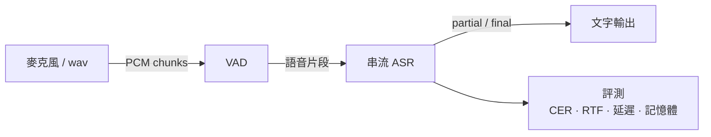

# ondevice-zh-asr

在 Apple 設備上實現**離線、低延遲的端側中文串流語音辨識**全鏈路：麥克風 / wav → VAD → 串流 ASR → 文字輸出 → 評測。

- 完全離線，不依賴雲端服務
- 串流輸出 partial 結果，以首字延遲為核心優化目標
- 所有結論都附可複現的量化指標（CER、RTF、首字延遲、峰值記憶體、模型大小）

> 🚧 開發中，目前處於第一階段。

## 架構

<!-- TODO: 實作完成後替換為實際架構圖 -->



## 快速開始

需求：Apple Silicon Mac、[uv](https://docs.astral.sh/uv/)。

```bash
uv sync                                   # 安裝依賴（含 Python 3.11）
uv run pytest                             # 跑測試
```

```bash
# TODO：以下命令尚未實作
uv run scripts/download_models.py         # 下載模型到 models/
uv run scripts/transcribe.py input.wav    # 辨識單一 wav
uv run scripts/mic_demo.py                # 麥克風即時辨識
uv run scripts/run_eval.py                # 在評測集上產生指標
```

## 指標

<!-- TODO: 由 scripts/run_eval.py 產生後填入 -->

評測集：AISHELL-1 test　|　機型：TBD　|　commit：TBD

| 設定 | CER (%) | RTF | 首字延遲 P50 / P90 (ms) | 峰值記憶體 (MB) | 模型大小 (MB) |
|---|---|---|---|---|---|
| 基準（FP32, CPU, 1 執行緒） | – | – | – / – | – | – |

指標定義見 [CLAUDE.md](CLAUDE.md#核心指標定義)。

## 專案結構

```
src/vad/       語音活動偵測
src/asr/       串流語音辨識
src/pipeline/  串接音訊輸入、VAD、ASR
eval/          評測（CER / RTF / 延遲 / 記憶體）
scripts/       一條命令可執行的入口腳本
tests/         單元測試
docs/          設計與實驗紀錄
models/ data/  模型與資料（不進版控）
```

## 路線圖

**第一階段：VAD + 串流 ASR + 評測**
- [ ] 模型下載腳本（含 checksum 校驗）
- [ ] VAD 模組
- [ ] 串流 ASR 模組
- [ ] pipeline：wav / 麥克風輸入
- [ ] 評測：CER、RTF、首字延遲、峰值記憶體、模型大小
- [ ] 基準指標寫入 README

**第二階段：量化與 Core ML**
- [ ] INT8 / FP16 量化與精度對比
- [ ] Core ML 轉換，CPU / GPU / ANE 對比

**第三階段：iOS demo**
- [ ] Swift + Core ML 即時辨識 app
- [ ] 裝置端指標量測

## License

TBD
