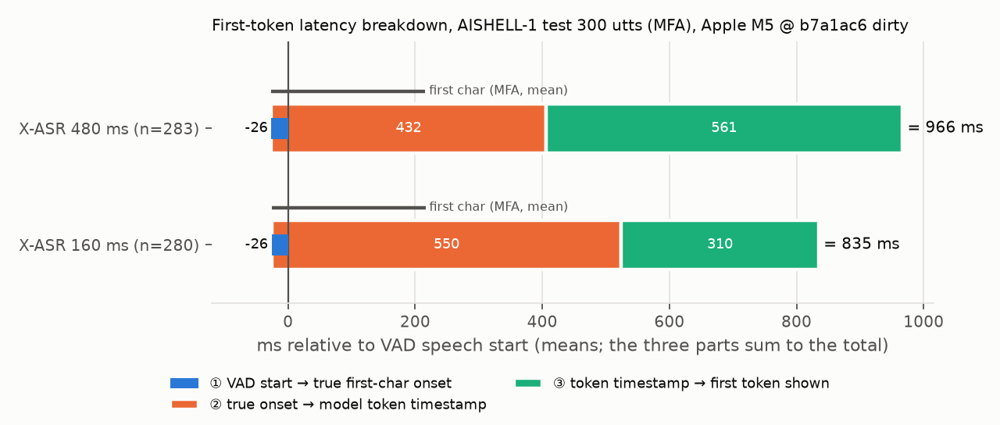
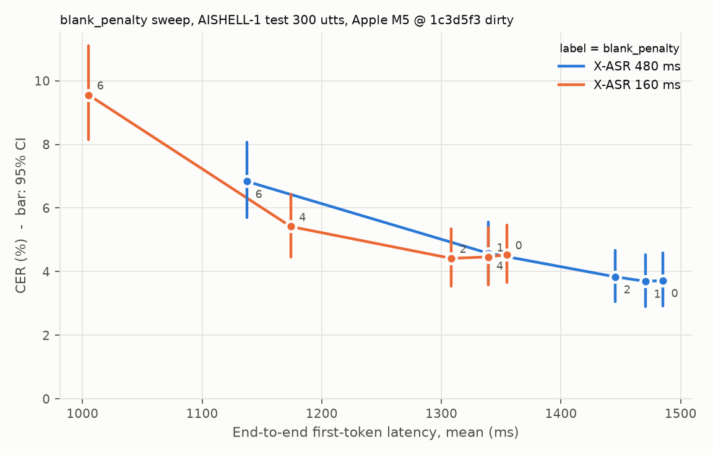

# 首字延遲分析：從「換小 chunk」到「模型晚出字」

2026-10-30 至 10-31 降低首字延遲的實驗過程：每一步的預期、實測、被推翻的假設，以及最後找到的原因。
各步驟的完整數字與指令在 [progress.md](progress.md)；指標定義見 [eval.md](eval.md)。

環境：Apple M5 / macOS 27.0.1 / onnxruntime 1.31.1 / sherpa-onnx 2.0.1，CPU 單執行緒，10 ms chunk 模擬即時；
VAD Silero v6.2.3（min_speech 250 ms、min_silence 500 ms、pad 30 ms），pre-roll 100 ms，每條音訊前補 1 秒靜音。

## 一頁摘要

| 階段 | 預期 | 實測 | 結論 |
|---|---|---|---|
| 1. 換 160 ms chunk | 首字延遲少約 320 ms（480 − 160） | 只少 128 ms，CER +0.94 個百分點（顯著） | 預期錯，預設維持 480 ms |
| 2. 新假設：VAD 確認（291 ms）露出來成為瓶頸 | VAD 預先啟動可省約 200 ms | VAD 確認 291 → 65 ms，首字延遲**完全不變** | 假設錯，瓶頸不在 VAD |
| 3. 新假設：模型晚出字，原因三選一 | 用字級對齊拆成三段 | 模型把首字放在**首字唸完後 190–310 ms**；其餘是 chunk 等待 | 主因是模型的輸出延遲，chunk 變小反而延遲更多 |
| 4. 推論端壓低輸出延遲：`blank_penalty` | 讓模型早點輸出 | penalty 2 省 40–47 ms（CER 不顯著）；penalty 4 省 150–180 ms 但 CER +0.9 個百分點 | 輸出延遲可移動，但要拿準確率換 |

## 1. 換更小的 chunk（B1）

**預期**：X-ASR 480 ms 的首字延遲約 1 秒，每個 chunk 計算只要約 13 ms，延遲幾乎都在等 chunk 收滿。換成同系列的 160 ms 版，延遲應該少約一個 chunk 差（320 ms）。

**量測前先修尺**：原本的首字延遲以 VAD 判定的語音起點為起點，等於用被測系統的一部分當尺。改成每條音訊前補 1 秒靜音，以「補靜音結束」為起點的**端到端首字延遲**與 VAD 無關（含原始音訊開頭未標註的靜音，只適合設定間相對比較）。

**實測**（AISHELL-1 test 3000 句）：

| 模型 | CER | 端到端首字 mean / P90 | 首字（VAD 起點）mean | RTF |
|---|---|---|---|---|
| X-ASR 480 ms | 4.11% | 1487 / 1623 ms | 972 ms | 0.030 |
| X-ASR 160 ms | 5.05% | 1359 / 1559 ms | 845 ms | 0.067 |

- 成對比較：端到端首字延遲平均 −128 ms（12% 的句子反而變慢），CER +0.94 個百分點（95% CI [0.77, 1.11]），RTF 2.2 倍。
- 只拿到預期的 40%，而且代價不小。**預設維持 480 ms。**

## 2. 第一個新假設：VAD 確認延遲露出來了（B2）

**推理**：VAD 要等語音持續 250 ms 才發出開始事件（實測平均 291 ms）。480 ms 版第一個 chunk 要 610 ms 音訊，VAD 的等待被蓋住；160 ms 版只要 290 ms，VAD 就會變成瓶頸。如果成立，「VAD 預先啟動」（一看到語音就建立 ASR stream）能再省約 200 ms。

**先查數據**：VAD 開始事件發出時，pipeline 已把約 390 ms 音訊一次送入，160 ms 模型已能解碼；但開始事件後 100 ms 內就出字的句子只有 0.1%（P10 仍要再等 409 ms）。

**上限實驗**：`--min-speech-ms 0`，VAD 第一個語音 frame 就建立 stream，相當於預先啟動且從不丟棄。100 句：

| 模型 | VAD 確認 | 首字（VAD 起點）mean / P90 | 端到端首字 mean | CER |
|---|---|---|---|---|
| 160 ms，min_speech 250 | 291 ms | 848 / 1024 ms | 1368 ms | 4.59% |
| 160 ms，min_speech 0 | 65 ms | 848 / 1024 ms | 1368 ms | 4.59% |

stream 提早 226 ms 建立，首字延遲到 ms 都沒變（480 ms 版相同）。送入模型的音訊不變，第一個字何時出現取決於音訊何時到達，與 stream 何時建立無關。**假設被推翻，B2 不實作。**

**新問題**：VAD 開始事件之後，模型還要平均 554 ms（160 ms 版）才輸出第一個字。可能的原因有三個：

- **H1** 模型的輸出延遲：transducer 學到晚一點才輸出字（聽到更多上下文再決定）。
- **H2** 架構需要的右側音訊：chunk 收滿 + 右側 context 才能解碼。
- **H3** 起點誤差：AISHELL 的第一個字比 VAD 判定的起點晚很多才開始發音。

## 3. 字級對齊拆解

### 方法

- **真實首字起點**：Montreal Forced Aligner 3.4.3 + Mandarin MFA 聲學模型 v3.0.0（GMM-HMM，CC BY 4.0，訓練資料不含 AISHELL-1），以字為單位對齊，邊界解析度 10 ms。從 3000 句集以固定 seed 抽 300 句（20 位說話人），300 句全部對齊成功。腳本 `scripts/prepare_alignment.py`。
- **模型首字時間戳**：sherpa-onnx 結果 JSON 的 `timestamps[0]`（encoder 輸出 frame，40 ms 解析度），加上該 stream 的起點換成音訊時間。pipeline 在第一個非空 partial 出現時記錄（`Utterance.first_token_audio_s`）。
- **量測本身**：先確認 partial 讀取不會造成誤差。把 VAD 開始時一次補送的音訊也改成每 10 ms 讀一次 partial，100 句首字時刻最多差 1.75 ms；首字時刻的解析度是 10 ms（chunk 到達）加上實測計算時間。
- **三段**（每條第一個有字的句段；首字辨識錯的 17 / 20 句不計入）：

  ① 真實首字起點 − VAD 判定起點　② 模型首字時間戳 − 真實首字起點　③ 首字出現時刻 − 模型首字時間戳

  依定義，逐句的 ① + ② + ③ 等於該句的首字延遲（VAD 起點）；下表三段平均的加總與合計一致（差 1 ms 為四捨五入）。腳本 `scripts/latency_breakdown.py`。

### 結果（ms）

| 模型 | 句數 | ① VAD → 真實起點 | ② 真實起點 → 時間戳 | 其中：首字結束 → 時間戳 | ③ 時間戳 → 出現 | 合計 |
|---|---|---|---|---|---|---|
| 480 ms | 283 | −26 / −18 / 2 | **432** / 418 / 563 | 190 / 188 / 292 | **561** / 606 / 648 | 966 / 1025 / 1029 |
| 160 ms | 280 | −26 / −18 / 0 | **550** / 553 / 740 | 308 / 301 / 470 | **310** / 320 / 325 | 835 / 861 / 1023 |

每格為 mean / P50 / P90。首字本身長度 mean 242 ms（P90 320 ms）。

### 三段各自的解釋

- **① ≈ −26 ms：H3 不成立。** VAD 起點比真實首字起點早約 26 ms（VAD 有 30 ms padding），P90 也只到 0–2 ms。VAD 切點很準，不是延遲來源。
- **③ 完全由架構決定（H2）。** 對每句計算（送入起點以 VAD 起點 − 100 ms 近似）「時間戳所在 chunk 的結尾 + 130 ms 右側 context − 時間戳」，③ 只比它多出固定的 31–34 ms（P10–P90 範圍 27–39 ms，含特徵視窗與計算）。480 ms 版的 ③ 比 160 ms 版多 251 ms，正是換小 chunk 拿到的收益。
- **② 是模型的輸出延遲（H1），而且是主因。** 模型把第一個字放在**首字唸完之後** 190 ms（480 ms 版）/ 308 ms（160 ms 版）。時間戳在 chunk 內的平均位置是 84 ms / 12 ms：模型幾乎總是在首字所在 chunk 的「下一個」chunk 開頭才輸出這個字，也就是先多聽一段後文再決定。

### 為什麼換小 chunk 只快 128 ms

chunk 從 480 縮到 160 ms，③ 少了 251 ms，但 ② 多了 118 ms：chunk 越小、每次看到的上下文越少，模型就把字延到更後面才輸出。兩者相抵，淨省 131 ms，與 3000 句上量到的 128 ms 一致。

## 4. 結論與可行改法

**主因是 H1（模型的輸出延遲）**：模型平均在首字唸完 0.2–0.3 秒後才輸出它，這段時間占首字延遲的 45%（480 ms）/ 66%（160 ms），而且 chunk 越小越嚴重。H2 的 chunk 等待是第二大來源，但已可用 chunk 大小控制，且換小 chunk 會被 H1 吃掉一部分。H3 不成立。

**推論端可以改的**（不需重新訓練）：

| 做法 | 針對 | 預期與風險 |
|---|---|---|
| sherpa-onnx `blank_penalty`（解碼時降低 blank 的分數） | ② | 已掃描（第 5 節）：penalty 2 省約 40 ms、CER 差異不顯著；penalty 4 省 150–180 ms、CER +0.9 個百分點 |
| 從原始 checkpoint 重新匯出較小的右側 context 或 chunk | ③ | X-ASR 是 offline-streaming 統一模型；能否用原始 checkpoint 以其他 chunk / 右側 context 重新匯出，取決於 checkpoint 是否公開（未確認）。由本次結果，縮 chunk 會被 ② 抵銷 |
| 換推論後端（Core ML / ANE） | 計算時間 | 計算只占 ③ 中約 30 ms 的一部分，幫助很小 |
| VAD 預先啟動 | — | 已證實無效（第 2 節） |

**需要重新訓練的**（第一階段範圍外，CLAUDE.md）：

| 做法 | 針對 | 說明 |
|---|---|---|
| 延遲懲罰訓練（例如 icefall pruned transducer 的 delay penalty、FastEmit 正則化） | ② | 訓練時懲罰晚輸出，直接壓低輸出延遲 |
| 縮小右側 context 或用更小的 chunk 訓練 | ③ | 右側 context 130 ms 是固定成本 |
| 對齊約束的 transducer 訓練（限制 token 只能在對齊位置附近輸出） | ② | 需要訓練資料的字級對齊 |

## 5. 推論端的嘗試：blank_penalty

在 300 句對齊集上掃描 sherpa-onnx 的 `blank_penalty`（0–8），完整數字見 [progress.md](progress.md)。

| 模型 | penalty | CER 差（成對，百分點）| 端到端首字差 | 首字結束 → 模型時間戳 |
|---|---|---|---|---|
| 480 ms | 2 | +0.12 [−0.28, +0.50] | −40 ms | 190 → 154 ms |
| 480 ms | 4 | +0.86 [+0.31, +1.45] | −146 ms | 190 → 92 ms |
| 160 ms | 2 | −0.12 [−0.50, +0.28] | −47 ms | 308 → 262 ms |
| 160 ms | 4 | +0.88 [+0.32, +1.48] | −181 ms | 308 → 163 ms |

- penalty 直接壓低 ②，證實拆解找到的主因是對的：輸出延遲可以用解碼參數移動。
- 但不是免費的：penalty ≤ 2 只省 40–47 ms（CER 差異在 300 句上不顯著），penalty 4 省 150–180 ms 時 CER 顯著變差約 0.9 個百分點；penalty ≥ 6 時模型在首字唸完前就輸出，CER 失控。
- 結論：模型晚出字有一部分是「需要聽到後文才能確定」的真實資訊需求，用解碼參數硬推只能拿準確率換延遲。要不付這個代價，需要在訓練時處理（延遲懲罰訓練等）。
- 預設維持 penalty 0；penalty 2 待 3000 句確認 CER 不變後再決定。

## 限制

- **MFA 邊界的誤差尚未人工驗證**：10 句抽查檔在 `data/aishell1_align_300/check/`（Praat TextGrid、Audacity 標籤），等人工確認後才能給出誤差範圍。結論對幾十 ms 的誤差不敏感（② 比首字結束點晚 190–310 ms）。
- 模型時間戳解析度 40 ms，且代表 token 被輸出的 encoder frame，不是模型「認為」的字邊界。
- AISHELL 是安靜環境的單句朗讀；首字以參考文本的第一個字為準，首字辨識錯的句子（5.7–6.7%）不計入。
- 300 句的平均值，沒有做信賴區間；兩個模型用同一批句子。
