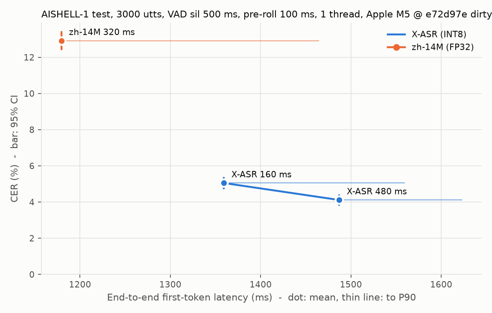

# 開發紀錄

按時間順序追加，新的紀錄放在最下面。

---

## 2026-10-30　VAD 模組（第一階段）

環境：Apple M5 / macOS 27.0.1 / Python 3.11 / onnxruntime 1.31.1，單執行緒，CPU。

### 做了什麼

- `scripts/download_models.sh`：下載模型到 `models/`，固定版本並校驗 SHA-256，可重複執行（校驗通過即跳過）。
  - Silero VAD **v6.2.3**（tag commit `5cd7945676`），MIT 授權
  - 來源：`https://raw.githubusercontent.com/snakers4/silero-vad/v6.2.3/src/silero_vad/data/silero_vad.onnx`
  - 路徑：`models/silero-vad-v6.2.3/silero_vad.onnx`，2.3 MB，FP32
  - SHA-256：`1a153a22f4509e292a94e67d6f9b85e8deb25b4988682b7e174c65279d8788e3`
- `src/vad/`
  - `silero.py`：`SileroVadModel`，以 ONNX Runtime 直接呼叫模型，逐 frame（512 樣本 / 32 ms）回傳語音機率。
  - `detector.py`：`VadConfig`（參數）、`StreamingVad`（串流：`accept_waveform(chunk)` / `flush()` → 開始 / 結束事件）、`detect_segments`（離線：整段音訊 → 語音段）。
  - `load_wav`：讀 16 kHz wav，多聲道取平均；取樣率不符直接報錯，不偷偷重取樣。
- `tests/test_vad.py`（19 個，連同既有冒煙測試共 23 個）：純靜音 / -60 dB 底噪無輸出；合成語音偵測到正確段數且起止誤差 < 100 ms；4 種 chunk 大小的串流結果與離線一致；用假分類器逐一驗證每個參數的行為。
- `tests/fixtures/vad_two_utterances.{wav,json}`：macOS `say`（Tingting）合成兩句中文，修掉頭尾靜音後放在已知位置，真實起止精確已知。產生腳本 `make_vad_fixture.py` 一併提交。
- `scripts/demo_vad.py`：輸入 wav 印出語音段；`--stream` 以 10 ms chunk 模擬即時送入，印出事件與延遲。

### 關鍵設計決策

1. **直接用 onnxruntime，不用 sherpa-onnx 的 VAD 介面。**
   - 評測需要中間量：首字延遲要用「VAD 觸發點」當語音起點，也要量 VAD 本身的演算法延遲。直接呼叫模型能拿到每 frame 機率與事件發出時刻；sherpa-onnx 只回傳切好的段落。
   - 第二、三階段要轉 Core ML、寫 Swift，模型 I/O（state、64 樣本 context、sr）與判斷規則遲早要自己掌握，現在用 Python 寫清楚，之後照搬。
   - 成本低：模型只有三個輸入，包裝約 40 行，context 處理已對照上游 `utils_vad.py`。sherpa-onnx 留給 ASR。
2. **離線與串流共用同一個狀態機。** 離線 = 整段送入串流再 `flush()`，兩者結果必然一致（有測試保證），避免兩套邏輯各自漂移。
3. **後端與判斷邏輯分離。** 狀態機只依賴 `FrameClassifier` 協定（`frame_size` / `__call__` / `reset`），換 Core ML 時只換模型包裝；測試也因此能用假分類器精確驗證規則。
4. **事件同時記錄位置與發出時刻**（`sample` / `detected_at`），兩者之差就是 VAD 的演算法延遲，供之後首字延遲的拆解使用。
5. **判斷規則與上游一致**：遲滯雙閾值；語音段內短於 `min_silence_ms` 的靜音不切段；含內部短靜音的總長不足 `min_speech_ms` 則丟棄；前後 padding 不跨越前一段終點、不超出音訊範圍。

### 目前的參數設定

與上游 Silero `get_speech_timestamps` 預設值相同，**尚未依評測調整**：

| 參數 | 值 | 說明 |
|---|---|---|
| `threshold` | 0.5 | 機率 ≥ 此值為語音 frame |
| `neg_threshold` | 0.35（= threshold − 0.15） | 機率 < 此值為靜音 frame，中間維持原狀態 |
| `min_speech_ms` | 250 | 語音段最短長度，也是串流「開始」事件的最小延遲 |
| `min_silence_ms` | 100 | 切段所需最短靜音，也是「結束」事件的最小延遲 |
| `speech_pad_ms` | 30 | 語音段前後延伸 |
| 執行緒數 | 1 | ONNX Runtime intra-op |

實測（合成測試音訊 6.2 s）：串流「開始」事件延遲 286 ms、「結束」98 ms；RTF 約 0.002–0.004（單次量測，未排除暖機，僅供量級參考）。

### 遇到的問題

- **自然口語下，逗號停頓與斷句停頓的長度重疊。** 用兩段自錄音訊驗收：
  - 錄音 1（自由說 3 句）：其中兩句之間的實際靜音只有約 290 ms，預設參數正確切成 3 段。
  - 錄音 2（照稿念 4 句，句間停約 1 秒）：偵測到 5 段。第 1 句逗號處停了 320 ms 被切開；其餘逗號停頓 64–96 ms 未被切開；句間停頓 1.5–3 s 皆正確切開；短句「對。」語音 288 ms，僅略高於 `min_speech_ms`，勉強保留。
  - 結論：句間停頓（290 ms）可能比逗號停頓（320 ms）還短，**單靠靜音長度不存在能同時切對兩段錄音的 `min_silence_ms`**，這是純聲學 VAD 的固有限制。
  - 對 ASR 而言，在句中誤切（丟失上下文、切點附近易錯）比誤合併（串流 ASR 可處理長段）代價高，因此 pipeline 傾向用較大的 `min_silence_ms`（候選 400–500 ms）與較小的 `min_speech_ms`（候選 150–200 ms）。**依驗證紀律，預設值暫不更動，待 pipeline 階段以 CER 對比後再定。**
- **在專案外層目錄執行 `uv run` 會用到錯的 Python。** 外層沒有 `pyproject.toml`，uv 退回 anaconda 的直譯器，出現 `ModuleNotFoundError: sounddevice`。所有 `uv run` 指令都要在 `ondevice-zh-asr/` 內執行。
- **測試本身要能區分對錯。** 遲滯測試的第一版，有無遲滯結果相同、等於沒測；改成機率落在雙閾值之間、會影響切段的序列，並加上 `neg_threshold = threshold` 的對照組。
- `scripts/` 下的腳本無法直接 `import src`（專案未安裝成套件），`demo_vad.py` 以插入 repo 根目錄到 `sys.path` 處理。

### 待辦

- pipeline 階段：以 CER 比較數組 `min_silence_ms` / `min_speech_ms`，決定 ASR 前端用的參數。
- 補一組有背景噪音（電視、風扇）的自錄樣本，檢查誤觸發。
- （可選）`demo_vad.py` 加 `--show-probs` 印出逐 frame 機率時間軸，方便調參。

---

## 2026-10-30　串流 ASR 模組（第一階段）

環境：Apple M5 / macOS 27.0.1 / Python 3.11 / sherpa-onnx 2.0.1，單執行緒，CPU。

### 選型

在 sherpa-onnx release `asr-models` 中比較串流中文模型（大小為推論所需檔案，非壓縮檔）：

| 模型 | 架構 | FP32 / INT8 (MB) | 訓練資料 | 備註 |
|---|---|---|---|---|
| **zipformer-zh-14M-2023-02-23**（選用） | transducer | 53 / 24 | WenetSpeech | 最小；同一壓縮檔含 FP32 與 INT8 |
| zipformer-small-ctc-zh-2025-04-01 | CR-CTC | 87 / 25 | 未註明 | 單一 onnx，轉 Core ML 較單純 |
| zipformer-multi-zh-hans-2023-12-13 | transducer | 約 2 倍 / 73 | 14k 小時（含 AISHELL-1 train） | AISHELL test 屬同領域 |
| zipformer-small-bilingual-zh-en-2023-02-16 | transducer | 110 / 47 | 中英 | 只在需要中英夾雜時考慮 |

更大的（zh-2025-06-30、x-asr 2026 系列，INT8 皆 120 MB 以上）先不考慮。選 14M 當第一個基準，換模型要等評測框架完成後以 CER 等指標對比。
注意：14M 只用 WenetSpeech 訓練，在 AISHELL-1 上是跨領域，CER 預期偏高。

### 做了什麼

- `scripts/download_models.sh`：新增 `fetch_archive`，下載 tar.bz2 → 校驗 SHA-256 → 解壓 → 寫入 `.sha256` 標記 → 刪除壓縮檔；標記吻合即跳過。
- `src/asr/base.py`：抽象介面 `StreamingAsr.create_stream()` → `AsrStream`，`accept_waveform(chunk)` / `get_partial_result()` / `finalize()`。基底類別統一處理 finalize 之後的狀態（再送入或重複 finalize 會報錯）。
- `src/asr/sherpa.py`：`SherpaTransducerAsr`。`accept_waveform` 內就把能解碼的音訊解碼完，讓計時包含計算；`finalize` 補 0.66 s 靜音（與官方範例一致）再 `input_finished()`。關閉 sherpa 的 endpoint detection，斷句交給 VAD。
- `src/asr/__init__.py`：`load_asr(name, num_threads)` 依名稱載入；新增後端只要實作兩個類別並登記名稱。
- `tests/test_asr.py`（10 個）：假後端驗證介面約定；用模型自帶 test_wavs 驗證 0.wav 與官方文件輸出完全一致、兩句對人工標註 CER ≤ 0.15、4 種 chunk 大小結果一致、partial 確實是串流（送一半就有、是最終結果的前綴、長度不倒退）、多個 stream 互不影響。
- `scripts/demo_asr.py`：依實際時長節奏逐 chunk 送入（`--fast` 不等待），印出 partial 變化與最終結果。

### 實測（單次量測，僅供量級參考）

| wav | 時長 | 結果 | CER（對人工標註） |
|---|---|---|---|
| 0.wav | 5.61 s | 对我做了介绍那么我想说的是大家如果对我的研究感兴趣 | 3/28（省略「啊、呢、呢」） |
| 1.wav | 5.15 s | 重点呢想谈三个问题首先就是这一轮全球金融动能的表现 | 2/26（省略「呢」，「动荡」→「动能」） |

10 ms chunk 時 RTF 約 0.06，100 ms chunk 約 0.014（chunk 越小呼叫開銷越大），finalize 8–27 ms。

### 待辦

- 評測框架完成後，在 AISHELL-1 test 上量 14M 基準，再決定是否換 small-ctc 或 multi-zh-hans。

---

## 2026-10-30　接入 X-ASR 480 ms 串流模型（INT8）

zh-14M 在自錄音訊上錯誤明顯（「下午」→「笑我」、「笔电」→「鼻垫」），改試 X-ASR。

### 選型

- X-ASR 在 sherpa-onnx release 有離線版與 160 / 480 / 960 / 1920 ms 四種 chunk 的串流版，各有 FP32、INT8、帶標點版本。
- 選 **480 ms 串流、不帶標點、官方 INT8 版**：
  - 串流：首字延遲是核心指標，離線版沒有 partial。
  - 480 ms：160 ms 準確度通常最差，1920 ms 已不算即時。其餘 chunk 與離線版等評測框架完成後再對比。
  - 不帶標點：第一階段不做標點，CER 計算前也會去標點。
  - INT8：FP32 版 encoder 單檔 566 MB，不適合端側。**偏離 CLAUDE.md「第一階段以 FP32 為基準」**，這是官方提供的量化版、非自行量化，報告時要註明精度。
- 檔案：encoder.int8 148 MB、joiner.int8 2.5 MB、decoder 10.8 MB（官方 INT8 版的 decoder 仍為 FP32），含 tokens 合計約 161 MB。原始模型 https://github.com/Gilgamesh-J/X-ASR，訓練資料與授權尚未確認。
- 註冊名稱 `x-asr-480ms-int8`；`load_asr` 預設仍是 `zipformer-zh-14m`，待評測後再決定預設。

### 句尾補零（tail padding）要依模型設定

encoder metadata：X-ASR 每個 chunk 48 frame（480 ms）、輸入 T = 61 frame（右側 context 13 frame）；zh-14M 為 32 / 39 frame。
X-ASR 用原本的 0.66 s 補零會漏掉句尾的字（例如 1.wav 少了「表现」）。在 6 個測試音訊上逐一嘗試：

| 補零 (s) | 結果 | finalize 耗時 (ms) |
|---|---|---|
| 0.66 | 4/6 句漏字 | – |
| 1.2 | 2/6 句漏字 | 27 |
| 1.4 / 1.6 | 與 3.0 s 完全相同 | 41 |
| 2.0 | 與 3.0 s 完全相同 | 55 |
| 3.0 | （基準） | 81 |

取 **1.6 s**（與 1.4 s 計算量相同、留餘量），在 registry 設定。zh-14M 補 0 / 0.66 / 3.0 s 結果都相同，維持 0.66 s。
補零不需等待真實時間，代價只有 finalize 的計算量，會計入尾字延遲。

### 對比（單次量測，僅供量級參考，正式數字待評測框架）

| | zh-14M（FP32） | X-ASR 480 ms（INT8） |
|---|---|---|
| 模型大小 | 53 MB | 161 MB |
| 載入時間 | 0.25 s | 1.0 s |
| 0.wav（CER） | 3/28，省略語氣詞 | 0/28 |
| 1.wav（CER） | 2/26，「动荡」→「动能」 | 0/26 |
| my_voice.wav | 你好克劳的你是谁 | 你好 CLOUD 你是谁 |
| my_voice_script.wav | …对**笑我**的会议…带**鼻垫**… | …对**下午**的会议…带**笔电**…（全對） |
| RTF（`--fast`，100 ms chunk） | 0.013–0.014 | 0.030–0.035 |
| 第一個 partial（0.wav，即時節奏） | 送入 0.73 s 時 | 送入 1.11 s 時 |
| finalize | 8 ms | 40 ms |

- X-ASR 準確度明顯較好，代價是體積約 3 倍、RTF 約 2.5 倍、第一個 partial 晚約 0.4–0.7 s（與 chunk 480 ms vs 320 ms 一致）。
- X-ASR 英文輸出為大寫並以空格分隔（如 `CLOUD`），CER 正規化需處理（轉小寫、去空白已在規則內）。

### 測試

`tests/test_asr.py` 的真實模型測試改為對每個已登記模型各跑一遍（共 39 個測試）。X-ASR 的 CER 上限設 0.05，同時用來抓補零不足（漏「表现」時 CER ≈ 0.077）。X-ASR 自帶的 test_wavs 沒有標註，未納入測試。

預設模型改為 `x-asr-480ms-int8`（`src.asr.DEFAULT_MODEL`，`load_asr()` 與 `demo_asr.py` 皆使用）。依據是上表的單次對比，AISHELL-1 上的正式數字待評測框架完成後補上；zh-14M 保留登記，供對比。

### 首字延遲粗量（單次，非正式評測）

8 句（兩模型自帶 test_wavs + 2 段自錄），10 ms chunk、模擬即時節奏；語音起點用 Silero VAD 第一段起點（含 30 ms padding）。
RTF << 1 不會積壓，因此 partial 出現時刻以「該 chunk 收齊的音訊時刻 + 該次計算時間」換算，未實際 sleep。

| 模型 | P50 | P90 | 最小 / 最大 |
|---|---|---|---|
| zh-14M | 572 ms | 687 ms | 188 / 732 ms |
| X-ASR 480 ms | 913 ms | 1035 ms | 513 / 1057 ms |

- X-ASR 的 partial 只在送入 0.63、1.11、1.59、2.07 s…時更新（首個 chunk 需 61 frame ≈ 0.61 s，之後每 48 frame = 0.48 s）；zh-14M 每 0.32 s 一次。
- 每次計算約 13 ms，延遲幾乎全是演算法延遲（等 chunk 收滿），換更快的後端（Core ML / ANE）幫助不大，要降延遲只能換更小的 chunk（如 X-ASR 160 ms 版）。
- **決定：暫時維持 480 ms 版**，160 ms 版等評測框架完成後再以 CER / 首字延遲對比。

---

## 2026-10-30　pipeline：VAD + 串流 ASR（第一階段）

### 做了什麼

- `src/pipeline/`：`StreamingPipeline(vad_model, asr, config)`，`accept_waveform(chunk)` / `flush()` → 事件（`start` / `partial` / `final`）。VAD「開始」→ 建立 ASR stream；語音中持續送入；VAD「結束」→ `finalize()`，整句結果存進 `pipeline.utterances`。離線便利函式 `transcribe(audio, ...)`。
- 每句（`Utterance`）記錄：語音起點 / 終點（VAD，含 padding）、實際送入 ASR 的起點（含 pre-roll）、VAD 開始 / 結束事件發出時刻、首字時刻、最終結果時刻、最終文字、partial 歷程；衍生首字延遲與尾字延遲。
- `scripts/run_pipeline.py`：輸入 wav，輸出 JSON（設定、機器、RTF、每句結果與時間戳；`--partials` 附 partial 歷程）。
- `tests/test_pipeline.py`（9 個）：假 VAD + 記錄輸入的假 ASR 精確驗證 pre-roll 起點、句間不重疊、時間順序、計算時間計入、與 chunk 大小無關；真實模型跑 fixture 兩句，檢查 CER、起止誤差、首字延遲範圍、chunk 大小無關。

### 關鍵設計決策

1. **pre-roll 用環形緩衝實作。** VAD「開始」事件比事件位置晚 min_speech_ms + padding（約 280 ms），所以 pipeline 保留最近約 min_speech + pad + pre_roll + 100 ms 的音訊，建立 stream 時從 `VAD 起點 − pre_roll` 補送。起點不早於上一句已送入 ASR 的終點，同一段音訊不會被辨識兩次。
2. **依 VAD 事件的樣本位置切分送入 ASR 的音訊，不依 chunk 邊界。** 一個大 chunk 內同時有結束與下一句開始時也能正確分配；送入 ASR 的音訊與 chunk 大小無關（有測試保證）。句子結束時送到 `detected_at`（含 min_silence_ms 的靜音尾巴）。
3. **時間戳用「模擬即時」虛擬時鐘，不真的 sleep。** chunk 最後一個樣本到達的音訊時刻 + 實際量測的計算時間；計算比音訊慢時自然積壓。與先前首字延遲粗量的方法一致，跑長音訊也不用等。時鐘可注入，測試因此可決定。

### pre-roll 小規模對比（單次，非正式評測）

7 句（zh-14M 自帶 0.wav / 1.wav 經 VAD 切成 5 句 + fixture 2 句），10 ms chunk，VAD 預設參數：

| pre-roll | X-ASR 480 ms | zh-14M |
|---|---|---|
| 0 ms | 文字與其他設定完全相同 | 「那么」→「什么」、「重点呢」漏「呢」 |
| 100 ms | 同上；首字延遲多數句比 0 ms 少 100 ms | 「感兴趣」→「感谢兴趣」，其餘最好 |
| 300 / 500 ms | 同上 | 「金融动荡」→「金融进入共党」等，明顯變差 |

- pre-roll 會改變 ASR chunk 與語音的對齊，首字延遲隨之非單調變化（同一句可差 ±480 ms，即一個 X-ASR chunk）。
- 預設取 **100 ms**（加上 VAD 30 ms padding，共比 VAD 起點早 130 ms 送入）。樣本太少，評測集完成後以 CER 重新決定。
- 注意：VAD 預設 `min_silence_ms = 100` 在這組音訊上把 0.wav、1.wav 各切成多句；pipeline 參數調整仍待評測（見 VAD 待辦）。

### 待辦

- 評測框架用 `transcribe` 產生首字 / 尾字延遲；在 AISHELL-1 上比較 pre-roll 與 `min_silence_ms`。
- 麥克風輸入（`scripts/mic_demo.py`）直接接 `StreamingPipeline`。

---

## 2026-10-30　評測框架與 VAD / pre-roll 參數掃描（第一階段）

環境：Apple M5（Mac17,3）/ macOS 27.0.1 / onnxruntime 1.31.1 / sherpa-onnx 2.0.1，單執行緒，CPU。
評測集：AISHELL-1 test 隨機 200 句（seed 20261030，17.2 分鐘，20 位說話人），10 ms chunk 模擬即時。
掃描在 commit `e9482b8` + 未提交的評測程式上執行（評測程式即 `f576d57` 提交的內容）；預設設定在 `f576d57` 上重跑，CER 與延遲逐位相同。
方法與指標定義見 [eval.md](eval.md)。

### 做了什麼

- `scripts/prepare_eval_data.py`：固定 seed 從 AISHELL-1 test（7176 句）抽 200 句，逐檔下載並以 SHA-256 校驗，寫出 `manifest.jsonl` / `meta.json`。
  - 官方 `AISHELL/AISHELL-1`（Hugging Face）只上傳了 100 位訓練集說話人；OpenSLR 只有 15 GB 完整包。改用保留原始目錄結構的鏡像 `shenyunhang/AISHELL-1`（固定 revision），只需下載約 33 MB。這是第三方鏡像，句數與標註檔大小與官方一致，音訊無法對官方 checksum 驗證。
- `eval/text_norm.py`：NFKC（全形轉半形）→ 小寫 → OpenCC 繁轉簡 → 去標點與符號 → 中文按字、英文按詞切 token。
- `eval/metrics.py`：jiwer 語料級 CER、延遲分位數。
- `eval/run_eval.py`：CER、RTF、首字 / 尾字延遲、峰值 RSS（獨立子程序）、模型大小、每條切段數；多值參數取笛卡兒積做掃描。每次結果記錄完整設定與環境，存成 `eval/results/<日期>_<設定名>.json`。
- `tests/test_eval.py`（16 個）：正規化規則、語料級 CER 不等於逐句平均、彙整邏輯、fixture 端到端。

### 掃描結果

`min_silence_ms` ∈ {100, 300, 500, 800} × `pre_roll_ms` ∈ {0, 100, 200, 300}，兩個模型共 32 組。其他 VAD 參數：threshold 0.5、min_speech 250 ms、pad 30 ms。

**CER (%)**（列：min_silence_ms，欄：pre_roll_ms）

| | X-ASR 0 | 100 | 200 | 300 | zh-14M 0 | 100 | 200 | 300 |
|---|---|---|---|---|---|---|---|---|
| 100 | 7.67 | 6.90 | 6.67 | 6.40 | 22.71 | 17.91 | 17.11 | 15.84 |
| 300 | 6.17 | 5.47 | 5.40 | 5.30 | 21.01 | 17.01 | 16.37 | 15.01 |
| **500** | 5.87 | **5.07** | 5.04 | 5.00 | 19.14 | 15.27 | 14.80 | 13.47 |
| 800 | 5.64 | 4.83 | 4.83 | 4.90 | 18.74 | 15.31 | 14.87 | 13.47 |

**首字延遲 mean / P90 (ms)**

| | X-ASR 0 | 100 | 200 | 300 | zh-14M 0 | 100 | 200 | 300 |
|---|---|---|---|---|---|---|---|---|
| 100 | 1028 / 1130 | 981 / 1029 | 943 / 943 | 901 / 1305 | 809 / 1060 | 674 / 956 | 652 / 860 | 658 / 760 |
| 300 | 1043 / 1129 | 992 / 1029 | 954 / 1054 | 908 / 1305 | 822 / 1372 | 678 / 956 | 655 / 860 | 664 / 760 |
| **500** | 1046 / 1129 | **990 / 1029** | 953 / 976 | 907 / 1305 | 830 / 1372 | 679 / 956 | 656 / 860 | 664 / 760 |
| 800 | 1051 / 1129 | 994 / 1029 | 959 / 1400 | 909 / 1305 | 831 / 1372 | 679 / 958 | 658 / 860 | 664 / 760 |

**VAD 切段與尾字延遲**（只與 min_silence_ms 有關；pre-roll 不影響切段，尾字延遲各 pre-roll 相差 < 2 ms）

| min_silence_ms | 每條平均段數（max） | 1 / 2 / 3+ 段的條數 | 尾字延遲 mean，X-ASR / zh-14M (ms) |
|---|---|---|---|
| 100 | 1.74 (6) | 101 / 67 / 32 | 147 / 110 |
| 300 | 1.42 (5) | 136 / 51 / 13 | 335 / 300 |
| **500** | 1.19 (3) | 168 / 27 / 5 | 447 / 410 |
| 800 | 1.07 (3) | 186 / 13 / 1 | 452 / 416 |

RTF：X-ASR 0.034–0.039、zh-14M 0.014–0.015，各設定之間差距在量測雜訊內（同設定重跑差約 5%）。峰值 RSS：X-ASR 531–538 MB、zh-14M 245–248 MB，與參數無關。沒有任何一句 VAD 整句漏掉。

**成對 bootstrap**（同樣 200 句重抽 5000 次，CER 差的 95% 信賴區間，單位：百分點）

| 比較（另一參數固定） | X-ASR | zh-14M |
|---|---|---|
| min_silence 100 → 500（pre 100） | −1.83 [−2.65, −1.09] | −2.63 [−3.58, −1.75] |
| min_silence 300 → 500 | −0.40 [−0.81, 0.00] | −1.73 [−2.54, −0.98] |
| min_silence 500 → 800 | −0.23 [−0.55, +0.07] | +0.03 [−0.27, +0.41] |
| pre-roll 0 → 100（sil 500） | −0.80 [−1.41, −0.20] | −3.87 [−5.22, −2.54] |
| pre-roll 100 → 200 | −0.03 [−0.66, +0.68] | −0.47 [−1.61, +0.62] |
| pre-roll 200 → 300 | −0.03 [−0.66, +0.54] | −1.33 [−2.40, −0.26] |

單一設定的 CER 本身 95% 信賴區間約 ±1.1 個百分點（X-ASR）/ ±2 個百分點（zh-14M），但同一批句子上的成對比較靈敏得多。

### 分析

1. **min_silence_ms 是 CER 的主要因素，問題正是切碎。** AISHELL 每條都是一句話，但 100 ms 時一半的音訊被切成 2 段以上（最多 6 段），句中停頓處被切開後 ASR 失去上下文。500 ms 時 84% 的音訊是 1 段。
2. **500 → 800 的收益不顯著，代價是尾字延遲。** 表中 500 / 800 的尾字延遲幾乎相同，這是**評測集造成的假象**：200 條音訊句尾靜音全部短於 800 ms（中位數 412 ms、89% 短於 500 ms），句子多半由音訊結束（flush）而非靜音計時結束，量到的尾字延遲被截斷。100 / 300 ms 時尾字延遲 ≈ min_silence + finalize（X-ASR 約 40 ms），即時輸入時 800 ms 應約為 840 ms，比 500 ms 多 300 ms 才出最終結果。
3. **pre-roll 0 → 100 ms 顯著改善 CER**（首字起音被 VAD 切掉）；X-ASR 在 100 ms 以上已無差異，zh-14M 則一路改善到 300 ms。
4. **首字延遲被 ASR chunk 量化。** X-ASR 第一個 chunk 需 61 frame（約 0.61 s）、之後每 0.48 s 更新一次。pre-roll 越長，第一個 chunk 越早收滿，所以多數句子的首字延遲剛好少 100 ms（P50：0 → 300 ms 為 1125 / 1025 / 926 / 827 ms）；但 chunk 中真正的語音也越少，比多數句子多等一個 chunk（+480 ms）的句子變多：pre-roll 0 / 100 / 200 / 300 時分別有 2 / 7 / 20 / 36 條（sil 500）。P90 因此在 1029 和 1305 之間跳動，pre-roll 200 的 P90 在 min_silence 500 時是 976、800 時是 1400，是因為那 20 條（10%）剛好落在 P90 邊界上。zh-14M 的 chunk 是 320 ms，量化較細，pre-roll 越長平均與 P90 都越好。
5. **VAD 確認語音的 291 ms（≈ min_speech 250 ms + frame 對齊）只要小於第一個 chunk 的等待時間就不會出現在首字延遲裡**，因為 pre-roll 的音訊在建立 stream 時一次補送。

### 決定

- **pipeline 預設 `min_silence_ms` 100 → 500**（`PipelineConfig` 的預設 VAD 設定；VAD 模組本身仍是上游預設值 100，`demo_vad.py` 不變）。100 → 500 兩個模型都顯著改善；500 → 800 不顯著，但每句最終結果晚 300 ms。代價：自然口語中句間停頓短於 500 ms 時兩句會合併（見 VAD 模組紀錄：實測句間停頓可短至 290 ms），但串流 ASR 能處理長段，partial 仍持續輸出，影響的只是「最終結果」的時機。
- **`pre_roll_ms` 維持 100**。X-ASR 上 100 / 200 / 300 CER 無顯著差異；200 的平均首字延遲少 37 ms，但需多等一個 chunk 的句子從 3.5% 增為 10%，P90 不穩定（976–1400 ms）；100 的 P90 在四種 min_silence 下都是 1029 ms。zh-14M 偏好 300 ms（CER 比 100 ms 低 1.8 個百分點、P90 低 196 ms），若之後改用 zh-14M 或其他 chunk 大小的模型，需要重新掃描。
- 預設設定（X-ASR 480 ms、sil 500、pre 100）：**CER 5.07%、RTF 0.036、首字延遲 990 / 1029 ms（mean / P90）、尾字延遲 449 ms（受上述截斷影響，即時約 540 ms）、峰值 RSS 533 MB、模型 163.6 MB**。

### 待辦

以下與先前各段的待辦已統一整理到 [backlog.md](backlog.md)（含優先級），之後以該檔為準。

- 首字延遲約 1 s，主要是 X-ASR 480 ms chunk 的演算法延遲（計算只佔約 13 ms / chunk）。下一步在同一評測集上比較 X-ASR 160 ms 版。
- 尾字延遲要在句尾留足靜音的音訊上量（例如在每條 wav 後補 1 s 靜音），才能反映 min_silence 的真實代價。
- 剩下 16% 的音訊仍被切成多段：可試 `threshold` / `neg_threshold` 或 ASR 端的 endpoint 規則。
- 多執行緒 RTF、X-ASR 參數量尚未量測。

---

## 2026-10-30　第一階段整理（不改演算法）

### 做了什麼

- 從乾淨 clone 照 README 快速開始走一遍，補上缺漏：要在 `ondevice-zh-asr/` 內執行、各步驟下載量與時間、pytest 預期結果（沒有模型時 24 個測試會被跳過而不是失敗）、麥克風 demo 的命令。
- 錯誤處理：`load_wav` 統一丟 `FileNotFoundError`（不存在）/ `ValueError`（無法解碼、取樣率不符），先前不存在或非音訊的檔案會讓 `demo_vad` / `demo_asr` / `run_pipeline` 印出 `LibsndfileError` traceback。`demo_asr` 改成先載入模型再讀 wav（預設 wav 在模型目錄內）。`demo_mic` 開啟裝置失敗、`prepare_eval_data` 網路錯誤、`run_eval` 空 manifest 都改成錯誤訊息 + 非零狀態碼。`--threads` / `--chunk-ms` 等參數在 argparse 階段檢查正負。
- 去重複：`src/audio.py`（`SAMPLE_RATE`、`load_wav`）、`src/paths.py`（`MODELS_DIR`）、`VAD_MODEL_NAME` 常數、`src/cli.py`（pipeline 共用參數與 `PipelineConfig` 建立，`run_pipeline` / `demo_mic` / `run_eval` 共用；顯示寬度函式）。原有的匯入路徑（`src.vad.load_wav`、`src.asr.SAMPLE_RATE`）保留。
- `ruff format` 全部通過；新增 `tests/test_audio.py`、`tests/test_cli.py`（共 84 個測試）。

### 驗證

重構後在同一評測集重跑預設設定（兩個模型）：200 句辨識結果逐句相同，CER、首字 / 尾字延遲、切段數、模型大小逐位相同；RTF 0.0364 → 0.0370（X-ASR）、0.0151 → 0.0157（zh-14M），在同設定重跑的雜訊範圍（約 5%）內。

---

## 2026-10-30　模型來源查證、3000 句評測集、記憶體探查（B6、B8、B11）

環境：Apple M5（Mac17,3）/ macOS 27.0.1 / onnxruntime 1.31.1 / sherpa-onnx 2.0.1，單執行緒，CPU。
評測在 commit `f6b11a8` + 未提交的程式上執行（結果 JSON 記錄為 `f6b11a8 (dirty)`），程式即 `982ca41` 提交的內容（之後只改了文件）。

### 模型來源與授權（B6）

完整查證與來源連結見 [models.md](models.md)，摘要：

- **X-ASR**：Apache-2.0（repo LICENSE、Hugging Face 模型卡）。訓練資料只有「約 100 萬小時開源及收集語音」一句，**沒有資料集清單；是否含 AISHELL-1 train / test 未知**。技術報告標示 Coming Soon。官方評測沒有 AISHELL-1。
- **zh-14M**：Apache-2.0。sherpa-onnx / sherpa-ncnn 文件寫明只用 WenetSpeech 訓練（子集未寫），依文件不含 AISHELL-1。
- **結論**：X-ASR 在 AISHELL-1 上的 CER 不能當作跨領域泛化能力，README 已註明；要有保證跨領域的數字，需要自錄的評測集（backlog B6a）。
- **公開 GitHub 的授權評估**：可公開（模型與資料都是寬鬆授權，repo 不散布權重與音訊）。唯一阻礙是 `tests/fixtures/vad_two_utterances.wav` 由 macOS 系統語音合成，macOS 授權排除公開散布系統語音（backlog B13）。

### 評測集改為 3000 句，CER 報告信賴區間（B8）

- `prepare_eval_data.py` 預設改為從 AISHELL-1 test 以同一 seed（20261030）隨機抽 3000 句（251.2 分鐘、20 位說話人、約 470 MB）；`-n 200` 仍產生原本的冒煙子集，`-n 7176` 為完整集。
  - 原本打算跑完整 7176 句（約 1.1 GB、約 10 小時音訊），下載速度約每分鐘 100 句；改用 3000 句以縮短下載與評測時間。代價是不能與論文的完整 test set 數字逐位對照。
  - 同一 seed 下 `random.sample` 前段的抽選幾乎相同，200 句中有 199 句也在 3000 句集裡（事後檢查發現，原先以為是各自獨立的抽樣）。中斷的完整集下載不能拿前段直接用：下載順序依句子 ID 排序，前 2700 句只涵蓋部分說話人。
- `run_eval.py` 預設改用 3000 句，`--smoke` 用 200 句。結果檔名加上評測集名稱（`<日期>_aishell1_test_3000_<設定>.json`），不同集的結果不再互相覆寫。
- CER 新增 95% 百分位 bootstrap 信賴區間（10000 次、seed 0），兩種重抽單位：句子、說話人（cluster bootstrap）。定義見 [eval.md](eval.md)。
- `prepare_eval_data.py` 修正：連線中斷造成的截斷回應（`http.client.IncompleteRead`）不是 `OSError`，原本不會重試，下載 7176 句時在第 2286 句中斷。現在一併重試（最多 5 次）。

**3000 句基準**（預設設定：sil 500、pre-roll 100、10 ms chunk）

| 模型 | CER (%) | 95% CI 以句 | 95% CI 以說話人 | S / D / I / N | RTF | 首字 mean / P90 (ms) | 尾字 mean (ms) | 每條切段數 | 峰值 RSS (MB) |
|---|---|---|---|---|---|---|---|---|---|
| X-ASR 480 ms | **4.15** | [3.89, 4.43] | [3.59, 4.75] | 1614 / 179 / 27 / 43813 | 0.0358 | 961 / 1029 | 453 | 1.18 | 618 |
| zh-14M | 13.49 | [13.00, 13.99] | [11.68, 15.31] | 4524 / 1131 / 255 / 43813 | 0.0155 | 665 / 958 | 417 | 1.18 | 333 |

**與 200 句子集對照**（同一份程式在 200 句上重跑：辨識結果、CER、首字延遲、切段數與 `f576d57` 相同；尾字延遲含實測計算時間，449 → 447 ms）

| 模型 | 200 句 CER [95% CI 以句] | 3000 句 CER [95% CI 以句] |
|---|---|---|
| X-ASR | 5.07 [4.04, 6.18] | 4.15 [3.89, 4.43] |
| zh-14M | 15.27 [13.34, 17.35] | 13.49 [13.00, 13.99] |

- 兩個模型在 3000 句上都比 200 句低約 1–2 個百分點，都在 200 句的信賴區間內：200 句剛好抽到比平均難的句子，不是程式改變（200 句重跑的辨識結果相同）。
- **以說話人重抽的區間寬 2.2 倍（X-ASR）/ 3.7 倍（zh-14M）**：錯誤率在說話人之間差異大，20 位說話人是不確定性的主要來源，多抽句子無法再縮小這部分。zh-14M 的說話人差異比 X-ASR 更明顯。
- 每條切段數 1.18（2548 / 365 / 87 條為 1 / 2 / 3+ 段），與 200 句的 1.19 一致；首字延遲 P90 都是 1029 ms（X-ASR）。
- RTF 與 200 句時相同（X-ASR 0.0354–0.0358）。

### 記憶體探查（B11）

新增 `scripts/probe_memory.py`：每個變體在獨立子程序中載入模型、整句送入解碼 N 句，記錄各階段 RSS。ORT 的 session 設定透過 sherpa-onnx provider 設定檔傳入（`provider="cpu:<設定檔>"`，sherpa-onnx 2.0.1 `csrc/session.cc` 支援 `EnableCpuMemArena`、`GraphOptimizationLevel`、`SessionConfig.*`；Python API 本身沒有這些參數）。

**RSS 基線與 session 設定**（X-ASR，解碼 30 句，MB）

| 變體 | 直譯器啟動 | import 後 | 載入後 | 解碼後 | peak | 載入增加 |
|---|---|---|---|---|---|---|
| default | 21 | 38 | 473 | 483 | 483 | 435 |
| `EnableCpuMemArena=0` | 21 | 38 | 472 | 483 | 483 | 434 |
| `session.disable_prepacking=1` | 20 | 38 | 466 | 473 | 473 | 428 |
| `GraphOptimizationLevel=0` | 21 | 38 | 616 | 622 | 622 | 577 |

zh-14M（30 句）：default 與 no-arena 都是載入後 190、peak 193 MB（載入增加 152 MB）。

**解碼句數的影響**（X-ASR，peak MB）：100 句 488 / 482（arena 開 / 關），1000 句 491 / 482。

**直接用 onnxruntime 載入同樣三個檔案**（每檔載入增加的 RSS，arena 開 / 關）：encoder.int8（148.1 MB）+217 / +222、decoder（10.8 MB）+22 / +22、joiner.int8（2.5 MB）+5 / +5，合計約 245 MB。

分析：

1. **arena 不是原因。** 關掉 CPU memory arena 後載入與峰值的變化都在 ±1 MB 內（1000 句時 peak 491 → 482，約 9 MB），因為 435 MB 的增加幾乎全部發生在**載入階段**，推論期間只再增加約 10–20 MB。arena 只影響推論時的暫存張量配置。
2. 關 prepacking 只少 7 MB；關圖最佳化反而多 144 MB（未融合的節點各自保留中間張量與權重格式）。
3. **經 sherpa-onnx 載入比直接用 onnxruntime 多約 190 MB**（435 vs 245）。兩邊的 ORT 函式庫不同（sherpa-onnx 自帶 `libonnxruntime.dylib`，Python 套件是 onnxruntime 1.31.1），差額來源見下一段的追查。
4. **評測的峰值 RSS 隨句數增加**：X-ASR 200 句 531 → 3000 句 618 MB、zh-14M 252 → 333 MB；但上面單獨解碼 100 → 1000 句只多 3 MB，所以增加的部分在評測 / pipeline 端（例如逐句結果累積或 partial 歷程），原因未查。在修正之前，不同評測集的峰值 RSS 不能直接比較（README 已註明）。
5. 決定：不改 `src/asr` 的 session 設定（沒有可量到的收益）。

### 待辦

見 [backlog.md](backlog.md)：B11（ORT 1.28 的載入碎片、評測端 RSS 增長）、B13（替換 fixture 後才能公開 repo）、B6a（不與訓練資料重疊的評測集）。VAD / pre-roll 掃描之後要在 3000 句集上重做。

### 追查：sherpa-onnx 載入多出的約 190 MB

問題：經 sherpa-onnx 載入 X-ASR 比直接用 onnxruntime 載入多約 190 MB RSS，是不是權重存了兩份？

方法：載入完成後在同一程序內執行 `vmmap --summary <pid>`，比較存活配置量（malloc zone 的 BYTES ALLOCATED）、已釋放未歸還（FRAG SIZE）與 physical footprint。直接載入用 `uv run --no-project --with onnxruntime==<版本>` 的臨時環境，不動專案依賴。

| 載入方式 | ORT 版本 | 存活配置 (MB) | 碎片 (MB) | 碎片比例 | physical footprint (MB) |
|---|---|---|---|---|---|
| sherpa-onnx 2.0.1 | 1.28.2（內附） | 219.0 | 182.5 | 46% | 259（載入時峰值 415） |
| onnxruntime | 1.28.0 | 222.1 | 191.7 | 47% | 443 |
| onnxruntime | 1.29.0 | 222.5 | 187.7 | 46% | 440 |
| onnxruntime | 1.30.0 | 222.2 | 33.7 | 14% | 286 |
| onnxruntime | 1.31.1（專案依賴） | 205.5 | 25.8–35.4 | 12–15% | 261–270 |

結論：

1. **沒有重複的權重。** 各版本的存活配置量都在 205–222 MB，比三個檔案合計（161 MB）多約 45–60 MB（這部分的組成未拆解）；sherpa-onnx 沒有比直接載入多存一份。
2. **多出來的是 ORT 1.28–1.29 載入時的暫存配置**：載入過程配置、用完釋放，但 malloc 沒有把這些頁面還給系統，仍計入 RSS。這和 sherpa-onnx 無關，同版本的 onnxruntime 直接載入也一樣；ORT 1.30.0 起降到約 34 MB。
3. 先前在 backlog 寫的推測「sherpa-onnx 先把檔案讀進記憶體再建 session」是錯的：讀 sherpa-onnx 2.0.1 原始碼（`csrc/online-zipformer2-transducer-model.cc`），桌面版是以檔案路徑建立 `Ort::Session`；先讀進緩衝的路徑只用於 Android / HarmonyOS 的 asset manager。
4. 這些碎片是同一程序之後可以重複使用的記憶體，所以推論期間 RSS 不會再大幅增加（解碼 1000 句只多 3 MB）。但評測報的 peak RSS（`ru_maxrss`）包含它。iOS 的 jetsam 依據的是 physical footprint；sherpa-onnx 這一行的 footprint（259 MB）比 RSS 低，但載入時的峰值仍到 415 MB。
5. sherpa-onnx 2.0.1 是 PyPI 最新版，目前無法只靠升版解決。可行做法是等上游升級 ORT，或自行以 ORT ≥ 1.30 編譯 sherpa-onnx（backlog B11）。第三階段改用 Core ML 時這個問題不存在，但要重新量。

磁碟上的評測資料（同一天檢查）：中斷的完整集下載 `data/aishell1_test_full/` 有 2936 個檔案，其中 1249 個以 hardlink 與 3000 句集共用（不佔額外空間），1687 個（約 260 MB）只在完整集裡、目前沒有用到。

---

## 2026-10-31　端到端首字延遲（B5 部分）、X-ASR 160 ms 對比（B1）

環境：Apple M5（Mac17,3）/ macOS 27.0.1 / onnxruntime 1.31.1 / sherpa-onnx 2.0.1，單執行緒，CPU。
評測在 commit `e72d97e` + 未提交的程式上執行（結果 JSON 記錄為 `e72d97e (dirty)`），程式即本次提交的內容。
評測期間同時有其他單執行緒工作在跑（模型下載、200 句掃描）；X-ASR 480 ms 的 RTF 換算成相同分母後與上次一致（見下），沒有看到干擾。

### 端到端首字延遲：不再用 VAD 本身當起點

- `run_eval.py` 新增 `--lead-silence-ms`（預設 1000）：每條音訊前補 1 秒數位靜音再送入 pipeline。
- 新增 `e2e_first_token_latency_ms` = 第一個非空 partial 的模擬即時時刻 − 補靜音結束點。與 VAD 無關，但含原始音訊開頭未知長度的靜音，**只適合設定間相對比較**。原本以 VAD 起點的首字延遲保留，兩者都報告。定義與限制見 [eval.md](eval.md)。
- RTF 的分母改為實際送入的音訊長度（含補靜音）。結果 JSON 的位置（`speech_start_s` 等）換回原始音訊時間軸。結果檔名加 `_lead1000`，不覆寫舊結果；`--lead-silence-ms 0` 重現舊設定。
- 開發時用 `--smoke --limit 20`（約 5 秒 / 模型）先確認能跑通，再跑 200 / 3000 句。

**補靜音前後**（3000 句，sil 500、pre-roll 100）

| 模型 | 補靜音 | CER (%) | RTF | 首字（VAD 起點）mean / P90 (ms) | 端到端首字 mean / P50 / P90 / P99 (ms) | 尾字 mean (ms) |
|---|---|---|---|---|---|---|
| X-ASR 480 ms | 0（上次，`f6b11a8`） | 4.15 | 0.0358 | 961 / 1029 | – | 453 |
| X-ASR 480 ms | 1000 ms | 4.11 | 0.0301 | 972 / 1029 | 1487 / 1533 / 1623 / 2073 | 451 |
| zh-14M | 0（上次） | 13.49 | 0.0155 | 665 / 958 | – | 417 |
| zh-14M | 1000 ms | 12.92 | 0.0134 | 666 / 958 | 1179 / 1144 / 1464 / 1844 | 416 |

- CER 小幅變化：1000 ms 不是 VAD frame（32 ms）的整數倍，補靜音讓 VAD frame 相對語音的切點位移。兩個模型都在上次的 95% CI 內。
- RTF 下降主要來自分母變大：0.0358 × 251.2 / 301.2 ≈ 0.0299，與 0.0301 一致。
- 端到端減 VAD 起點約 515 ms（X-ASR）/ 513 ms（zh-14M），兩個模型幾乎相同，符合「差值 = 原始音訊開頭靜音 + VAD 起點位置，與模型無關」的預期。

### X-ASR 160 ms INT8（B1）

- 查過的候選（sherpa-onnx release `asr-models` 中的中文串流模型）：X-ASR 160 / 960 ms INT8；`streaming-zipformer-zh-int8-2025-06-30`（multi-zh-hans large，約 160M）與 `multi-zh-hans-int8-2023-12-13`，兩者依 icefall `egs/multi_zh-hans/ASR/README.md` 訓練資料含 AISHELL-1（170 h），在 AISHELL-1 test 上是同領域、不能公平比較；`streaming-zipformer-small-ctc-zh-int8-2025-04-01`（需新增 CTC 後端，訓練資料未知）。**只下載 160 ms INT8。**
- 檔案：`sherpa-onnx-x-asr-160ms-streaming-zipformer-transducer-zh-en-int8-2026-06-05`（release `asr-models`，SHA-256 `bdf2c0f2…`，為 GitHub release 記錄的 digest；同一來源對 480 ms 版的 digest 與先前固定的值一致）。來源、授權、訓練資料與 480 ms 版相同（同一系列），見 [models.md](models.md)。
- encoder metadata：`decode_chunk_len` 16（160 ms）、`T` 29（右側 context 13 frame）；encoder.int8 148.1 MB，與 480 ms 版大小相同。
- 參數量：X-ASR README 的比較表列 0.16B（標為 offline 模式；README 說是 offline-streaming 統一模型）。
- 註冊名稱 `x-asr-160ms-int8`，預設模型不變。

**句尾補零**：整句送入（不經 VAD），與補 3.0 s 的結果逐句比對（200 句 AISHELL + 4 個官方 test_wavs）。

| 補零 (s) | 與 3.0 s 不同的句數 | finalize mean (ms) |
|---|---|---|
| 0.64 | 15 / 54（前 50 句） | 40 |
| 1.0 | 4 / 54 | 62 |
| 1.6（480 ms 版的值） | 3 / 204 | 97 |
| **2.0** | 0 / 204 | 121 |
| 2.4 / 4.0 | 0 / 204 | 146 / 245 |

取 2.0 s。小 chunk 版需要的補零反而比 480 ms 版（1.6 s）長，原因未查；finalize 計算量也較大（每秒音訊要跑 6.25 次 encoder，480 ms 版約 2 次）。

**pre-roll 掃描**（200 句子集）：

| 模型 | pre-roll | CER (%) [95% CI] | 端到端首字 mean / P90 (ms) | 首字（VAD 起點）mean / P90 (ms) |
|---|---|---|---|---|
| 160 ms | 0 | 6.20 [4.98, 7.49] | 1404 / 1599 | 890 / 1119 |
| 160 ms | **100** | 5.54 [4.41, 6.79] | 1364 / 1559 | 850 / 1023 |
| 160 ms | 200 | 5.40 [4.29, 6.60] | 1365 / 1559 | 851 / 1077 |
| 160 ms | 300 | 5.60 [4.54, 6.72] | 1361 / 1549 | 847 / 985 |
| 480 ms | 0 / 100 / 200 / 300 | 5.40 / 5.14 / 4.80 / 4.77 | 1561 / 1515 / 1480 / 1451（mean） | – |

160 ms 的 100 / 200 / 300 差異都在 CI 內，維持 100 ms，與 480 ms 只差模型。

**3000 句對比**（sil 500、pre-roll 100、補靜音 1000 ms）

| 模型 | chunk | CER (%) | 95% CI 以句 | RTF | 端到端首字 mean / P50 / P90 / P99 (ms) | 首字（VAD 起點）mean / P90 | 尾字 mean / P90 (ms) | peak RSS (MB) |
|---|---|---|---|---|---|---|---|---|
| X-ASR | 160 ms | 5.05 | [4.76, 5.35] | 0.0670 | 1359 / 1369 / 1559 / 1819 | 845 / 1023 | 523 / 601 | 626 |
| X-ASR | 480 ms | **4.11** | [3.85, 4.38] | 0.0301 | 1487 / 1533 / 1623 / 2073 | 972 / 1029 | 451 / 528 | 622 |
| zh-14M | 320 ms | 12.92 | [12.44, 13.41] | 0.0134 | **1179** / 1144 / 1464 / 1844 | 666 / 958 | 416 / 494 | 335 |

取捨圖：[latency_tradeoff.png](latency_tradeoff.png)（`uv run scripts/plot_latency_tradeoff.py` 產生）。

成對比較（同一批 3000 句，160 − 480）：

- **CER +0.94 個百分點，95% 成對 bootstrap CI [0.77, 1.11]**（以句重抽 10000 次、seed 0），顯著變差（相對 +23%）。X-ASR README 自己的 benchmark 上 160 ms 也比 480 ms 差約 0.5–1.2 個百分點，方向一致。
- **端到端首字延遲逐句差：mean −128 ms、P50 −164 ms、P10 −324 ms、P90 +156 ms**；88% 的句子變快，12% 反而變慢。
- 尾字延遲 +72 ms（finalize 補零較長、encoder 次數較多）。RTF 2.2 倍。

**延遲拆解：VAD 確認不是瓶頸**（每條第一個有字的句段）

| 模型 | VAD 確認（語音起點 → start 事件）mean | start 事件 → 首字 mean / P10 / P50 / P90 | start 事件後 100 ms 內出字的比例 |
|---|---|---|---|
| 160 ms | 291 ms | 554 / 409 / 569 / 729 ms | 0.1% |
| 480 ms | 291 ms | 681 / 253 / 733 / 743 ms | 0% |

- 上一版 backlog 的推測是「換小 chunk 後 VAD 確認延遲會露出來」，**數據不支持**：VAD 發出 start 事件時，pipeline 已把 pre-roll 起的約 390 ms 音訊（100 + 291 ms）一次送入，160 ms 模型（需 290 ms 特徵）此時已能解碼，但 P10 仍要再等 409 ms 才出第一個字，幾乎沒有句子在 start 事件當下就出字。
- 也就是說，160 ms 模型的首字是由**模型本身多晚輸出第一個字**決定的，VAD 的 291 ms 被蓋住了。chunk 從 480 縮到 160 ms 只省約 130 ms，遠小於 chunk 差（320 ms）。
- 模型為何晚出字（transducer 的輸出延遲、需要更多右側音訊、或 AISHELL 的首字起音比 VAD 起點晚）目前無法區分，需要有字級時間對齊的評測集（B4 / B5）。
- 對 B2（VAD 預先啟動）的影響：在這兩個模型上，提早建立 stream 預期幫助有限，因為首字不是卡在 VAD。做 B2 前要先確認瓶頸。

### 決定

- **預設模型維持 X-ASR 480 ms。** 160 ms 換到平均 128 ms 的首字延遲，代價是 CER 相對 +23%（顯著）、RTF 2.2 倍、尾字 +72 ms，不划算。
- zh-14M 首字延遲最低（端到端比 X-ASR 480 ms 少約 300 ms），但 CER 高 3 倍，不考慮。
- 首字延遲要再降，方向從「換更小 chunk」改為先弄清楚模型的輸出延遲（B4 / B5 的對齊資料）。

### 測試

- `tests/test_eval.py`：彙整的端到端首字延遲；端到端測試檢查 `lead_silence_ms`、檔名 `_lead1000`，以及端到端延遲大於 VAD 起點延遲。
- `tests/test_asr.py`：`x-asr-160ms-int8` 加入真實模型測試（0.wav 1/28、1.wav 0/26）。
- `uv run pytest` 94 passed、mypy strict、ruff 通過。

### 追加：VAD 預先啟動的上限實驗（B2）

問題：如果 VAD 一看到語音就建立 ASR stream（「預先啟動」），首字延遲最多能省多少？

方法：`--min-speech-ms 0`，VAD 第一個語音 frame 就發出 start 事件。這相當於預先啟動且從不丟棄，是預先啟動在延遲上的上限，不需要改程式。200 句子集前 100 句，其他設定同上（sil 500、pre-roll 100、補靜音 1000 ms）。

| 模型 | min_speech_ms | VAD 確認 mean (ms) | CER (%) | 首字（VAD 起點）mean / P90 (ms) | 端到端首字 mean / P90 (ms) | 每條切段數 | RTF |
|---|---|---|---|---|---|---|---|
| 160 ms | 250 | 291 | 4.59 | 848 / 1024 | 1368 / 1533 | 1.14 | 0.0695 |
| 160 ms | 0 | 65 | 4.59 | 848 / 1024 | 1368 / 1533 | 1.14 | 0.0690 |
| 480 ms | 250 | 291 | 4.59 | 1014 / 1029 | 1534 / 1623 | 1.14 | 0.0308 |
| 480 ms | 0 | 65 | 4.59 | 1014 / 1029 | 1534 / 1623 | 1.14 | 0.0307 |

- stream 平均提早 226 ms 建立，但兩個模型的首字延遲、CER、切段數**完全相同**（到 ms）。VAD 起點位置（含 pre-roll 的送入起點）不變，送進模型的音訊相同；第一個字輸出的時刻取決於音訊何時到達，與 stream 何時建立無關。
- 結論：在 X-ASR 160 / 480 ms 上，VAD 預先啟動**不會降低首字延遲**，只會在誤觸發時多出計算量。AISHELL 是安靜環境的單句，本實驗量不到誤觸發；就算量到，也沒有延遲收益可以拿來抵。
- 決定：不實作 B2。只有在換成首字確實卡在 VAD 的模型（start 事件當下即出字的比例明顯 > 0）時再重新評估。

---

## 2026-10-31　首字延遲拆解：字級對齊（B5 小規模版）

完整的推論過程與結論見 [latency-analysis.md](latency-analysis.md)，這裡記錄做了什麼與數字。
環境同上；評測在 commit `b7a1ac6` + 未提交的程式上執行，程式即本次提交的內容。

### 量測檢查

- partial 在每次送入音訊後讀一次（平常每 10 ms）。VAD 開始事件時會一次補送約 390 ms，補送完才讀。改成補送也每 10 ms 讀一次做對照（100 句、兩個模型）：首字時刻差 mean 0.04 / 0.06 ms、max 1.75 ms，沒有句子差超過 5 ms，首字也從未在補送當下出現。**不需修正。**
- 首字時刻解析度：音訊到達以 chunk（10 ms）為單位，計算時間用 `perf_counter` 實測。

### 做了什麼

- `AsrStream.get_token_timestamps()`（預設 None）；sherpa-onnx 後端讀結果 JSON 的 `timestamps`（40 ms 解析度，以 stream 第一個樣本為 0）。pipeline 在第一個非空 partial 出現時記錄 `Utterance.first_token_audio_s`，評測結果每個句段新增 `first_token_audio_s`（原始音訊時間軸）。
- `scripts/prepare_alignment.py`：從 3000 句集以 seed 20261031 抽 300 句（20 位說話人），以字為單位跑 MFA，輸出 `data/aishell1_align_300/`（manifest、`alignments.jsonl`、10 句抽查檔）。
  - MFA 3.4.3（conda-forge，獨立 conda 環境 `mfa`，不進專案依賴）；Mandarin MFA acoustic v3.0.0（GMM-HMM，MFCC + pitch，frame shift 10 ms，fMLLR 說話人調適）、mandarin_china_mfa 詞典與 G2P，皆 CC BY 4.0。聲學模型訓練資料：Common Voice zh-CN / zh-TW v16.1、aidatatang_200zh、AISHELL-3、THCHS-30、GlobalPhone，**不含 AISHELL-1**（MFA models 文件）。
  - 上游沒有公布 checksum，腳本固定 2026-10-31 下載時的 SHA-256。`mfa model download` 在不穩的網路下沒有重試，改用 curl 下載到 `models/mfa/`。
  - `.lab` 逐字以空白分隔並加 `--no_tokenization`（否則 MFA 要另裝中文分詞套件）。300 句的 1051 個字都在詞典裡。
  - 300 / 300 句對齊成功（全形「ｋ」被 MFA 轉成「k」，比對時兩邊做 NFKC + 小寫）。耗時 34 秒（4 個 job）。首字起點中位數 0.49 s，首字長度中位數 230 ms。
- `scripts/latency_breakdown.py`：三段拆解、`docs/latency_breakdown.png`、數字存 `eval/results/<日期>_aishell1_align_300_breakdown.json`。

### 300 句評測（含 token 時間戳）

| 模型 | CER (%) [95% CI] | 首字（VAD 起點）mean / P90 | 端到端首字 mean / P90 | RTF |
|---|---|---|---|---|
| 480 ms | 3.72 [2.91, 4.58] | 973 / 1029 | 1485 / 1623 | 0.0302 |
| 160 ms | 4.53 [3.66, 5.47] | 842 / 1023 | 1355 / 1589 | 0.0678 |

與 3000 句的值一致（首字延遲差 < 10 ms）。

### 拆解結果（mean / P50 / P90，ms）

| 模型 | 句數 | ① VAD → 真實首字起點 | ② 真實起點 → 模型時間戳 | 首字結束 → 模型時間戳 | ③ 時間戳 → 首字出現 | 合計 |
|---|---|---|---|---|---|---|
| 480 ms | 283 | −26 / −18 / 2 | 432 / 418 / 563 | 190 / 188 / 292 | 561 / 606 / 648 | 966 / 1025 / 1029 |
| 160 ms | 280 | −26 / −18 / 0 | 550 / 553 / 740 | 308 / 301 / 470 | 310 / 320 / 325 | 835 / 861 / 1023 |

- 首字辨識錯（假設首字 ≠ 參考首字）的 17 / 20 句不計入。
- ③ 對照架構推算：「時間戳所在 chunk 結尾 + 130 ms 右側 context − 時間戳」（送入起點以 VAD 起點 − 100 ms 近似），③ 只多出 31–34 ms（P10–P90 27–39 ms）。時間戳在 chunk 內的平均位置 84 ms（480）/ 12 ms（160）：模型幾乎總在下一個 chunk 開頭才輸出首字。

### 結論

- **主因是模型的輸出延遲（②）**：模型在首字唸完 190 / 308 ms 後才輸出它，chunk 越小越晚。VAD 切點準確（①）；③ 是 chunk + 右側 context 的架構成本，可完全解釋。
- 換 160 ms：③ −251 ms、② +118 ms，淨 −131 ms，與 3000 句的 −128 ms 一致。
- 推論端唯一直接針對 ② 的做法是 sherpa-onnx 的 `blank_penalty`（`from_transducer` 有此參數），下一步掃描它對 ② 與 CER 的影響。延遲懲罰訓練、FastEmit 等需重新訓練，不在第一階段範圍。

### 待確認

- **MFA 對齊的人工抽查**：`data/aishell1_align_300/check/` 的 10 句（`.TextGrid` 給 Praat，`.txt` 是 Audacity 標籤）。抽查前 MFA 邊界的誤差範圍未知。

### 測試

- `tests/test_pipeline.py`：假後端的 token 時間戳換算到音訊時間軸；真實模型的首字時間戳落在送入範圍內且不晚於首字出現時刻。
- `uv run pytest` 95 passed、mypy strict、ruff 通過。

---

## 2026-10-31　blank_penalty 掃描（推論端降低輸出延遲）

依字級拆解的結論，主因是模型晚輸出首字。推論端唯一直接針對它的是 sherpa-onnx 的 `blank_penalty`：解碼時從 blank 的 log 機率減去固定值，讓模型較早輸出非 blank token。
環境同上；評測在 commit `1c3d5f3` + 未提交的程式上執行，程式即本次提交的內容。

### 做了什麼

- `SherpaTransducerConfig.blank_penalty`（預設 0）、`load_asr(..., blank_penalty=)`、`run_eval.py --blank-penalty`（可多值掃描，非 0 時結果名稱加 `_bp<值>`）。預設不變。
- `scripts/plot_blank_penalty.py` → [blank_penalty_tradeoff.png](blank_penalty_tradeoff.png)；`latency_breakdown.py --config ..._bp<值>` 拆解各 penalty，結果檔名含設定。
- 先用 20 句試跑（penalty 0 / 1 / 2，160 ms：首字 −15 / −24 ms），再在 300 句對齊集上掃 0 / 1 / 2 / 4 / 6 / 8，兩個模型共 12 組，約 17 分鐘。

### 結果（300 句對齊集）

| 模型 | penalty | CER (%) [95% CI] | 端到端首字 mean / P90 (ms) | ② 真實起點 → 時間戳 mean | 首字結束 → 時間戳 mean | ③ mean |
|---|---|---|---|---|---|---|
| 480 ms | 0 | 3.72 [2.91, 4.58] | 1485 / 1623 | 432 | 190 | 561 |
| 480 ms | 1 | 3.70 [2.91, 4.52] | 1471 / 1623 | 419 | 176 | 560 |
| 480 ms | 2 | 3.84 [3.05, 4.67] | 1445 / 1623 | 397 | 154 | 555 |
| 480 ms | 4 | 4.58 [3.68, 5.56] | 1339 / 1593 | 334 | 92 | 508 |
| 480 ms | 6 | 6.84 [5.70, 8.07] | 1138 / 1533 | 222 | −21 | 431 |
| 480 ms | 8 | 23.58 [20.93, 26.50] | 1062 / 1142 | 36 | −206 | 537 |
| 160 ms | 0 | 4.53 [3.66, 5.47] | 1355 / 1589 | 550 | 308 | 310 |
| 160 ms | 1 | 4.46 [3.59, 5.38] | 1339 / 1560 | 535 | 293 | 311 |
| 160 ms | 2 | 4.42 [3.54, 5.35] | 1308 / 1529 | 504 | 262 | 308 |
| 160 ms | 4 | 5.42 [4.45, 6.44] | 1174 / 1370 | 406 | 163 | 279 |
| 160 ms | 6 | 9.56 [8.14, 11.11] | 1005 / 1180 | 266 | 22 | 251 |
| 160 ms | 8 | 39.41 [35.34, 43.86] | 901 / 1019 | 145 | −94 | 277 |

拆解只計首字辨識正確的句子；首字辨識錯的句數隨 penalty 增加（480：17 → 36，160：20 → 96），penalty ≥ 6 的拆解樣本有偏差。

**成對比較（同一批 300 句，相對 penalty 0；以句重抽 10000 次）**

| 模型 | penalty | CER 差（百分點）[95% CI] | 端到端首字差 (ms) [95% CI] |
|---|---|---|---|
| 480 ms | 1 | −0.02 [−0.35, +0.30] | −15 [−24, −6] |
| 480 ms | 2 | +0.12 [−0.28, +0.50] | −40 [−55, −26] |
| 480 ms | 4 | **+0.86 [+0.31, +1.45]** | −146 [−171, −122] |
| 480 ms | 6 | **+3.12 [+2.25, +4.06]** | −348 [−374, −320] |
| 160 ms | 1 | −0.07 [−0.35, +0.21] | −16 [−21, −10] |
| 160 ms | 2 | −0.12 [−0.50, +0.28] | −47 [−56, −38] |
| 160 ms | 4 | **+0.88 [+0.32, +1.48]** | −181 [−195, −167] |
| 160 ms | 6 | **+5.02 [+3.92, +6.24]** | −350 [−365, −334] |

### 分析

- **penalty 確實壓低了輸出延遲（②）**，與拆解的結論一致：penalty 4 時，模型把首字放在首字結束後 92 ms（480）/ 163 ms（160），penalty 0 時是 190 / 308 ms。
- **penalty ≤ 2：首字延遲少 40–47 ms，300 句上 CER 差異不顯著**；但信賴區間約 ±0.4 個百分點，不能排除小幅變差。
- **penalty 4：再多省約 100–140 ms，CER 顯著變差約 0.9 個百分點**（相對 +23%）。
- **penalty ≥ 6：模型在首字還沒唸完就輸出（首字結束 → 時間戳 ≤ 22 ms，甚至為負），等於在猜**，CER 失控（penalty 8 為 24% / 39%）。
- penalty 也讓 ③ 變小一些（480：561 → 508 ms @ 4），因為字較早輸出，落在 chunk 內較前面的位置。
- 兩條路徑會到達相近的點：480 ms + penalty 4（CER 4.58%、1339 ms）與 160 ms + penalty 0–1（4.46–4.53%、1339–1355 ms）幾乎重疊；160 ms + penalty 2（4.42%、1308 ms）略好，但 RTF 是 480 ms 的 2.3 倍。

### 決定

- **預設維持 X-ASR 480 ms、penalty 0**（2026-10-31 決定，依 300 句結果，不再等 3000 句）。不採用 penalty 2：只省約 40 ms（約首字延遲的 4%，感受不到），300 句的 CER 信賴區間仍容許最多約 +0.5 個百分點；參數保留為選項（`--blank-penalty`）。3000 句驗證列為有空再做。
- 想再降 100 ms 以上的首字延遲，推論端只剩用 CER 換（約每 100 ms 換 +0.6–0.9 個百分點）；不付這個代價就需要重新訓練（延遲懲罰訓練等，第一階段範圍外）。

### 測試

- `tests/test_asr.py`：`blank_penalty` 傳到後端並反映在模型名稱上。`tests/test_eval.py`：非預設設定反映在結果名稱上。
- `uv run pytest` 97 passed、mypy strict、ruff 通過。

---

## 2026-10-31　斷句與尾字延遲診斷（B3、B9 第一步：只量測，不改演算法）

何時判定一句話結束。環境同上；評測在 commit `43282fe` + 未提交的程式上執行，程式即本次提交的內容。數字由 `uv run scripts/endpoint_diagnosis.py` 重現，存 `eval/results/<日期>_endpoint_diagnosis.json`。

### 做了什麼

- **修正尾字延遲量測（B3）**：`run_eval.py --tail-silence-ms`（預設 1500），每條音訊後補數位靜音，句子改由 VAD 靜音計時收尾。3000 句預設設定：CER 4.11% → 4.11%（D 156 → 153）、切段分佈不變；**尾字延遲 451 → 531 ms**（P90 528 → 542），與「min_silence + 約 30 ms」一致，舊值是被截斷的。
- **新指標「最終文字就緒時間」**：`Utterance.final_text_ready_s`，最終結果的完整文字第一次出現在 partial 中的時刻；評測結果逐句段記錄 `end_emitted_s`、`final_text_ready_s`、`final_s`。
- **`run_eval.py --jobs N`**：並行子程序（見 eval.md「並行」）。profile 顯示 85% 時間在 ASR 推論、9% 在 VAD，Python 開銷 < 2%；`--jobs 2` 延遲偏差 ≤ 5 ms、牆鐘時間約減半，`--jobs 4` 會讓 RTF 翻倍、尾字延遲 +49 ms，不適合量延遲。
- `scripts/endpoint_diagnosis.py`：下列四項分析。

### 1. 句尾時間線（300 句對齊集，相對 MFA 真實末字結束點，ms：mean / P10 / P50 / P90）

| | X-ASR 480 ms | X-ASR 160 ms |
|---|---|---|
| VAD 終點（含 30 ms pad） | 50 / −12 / 52 / 124 | 57 / −12 / 53 / 124 |
| VAD 結束事件 | 536 / 470 / 540 / 610 | 543 / 470 / 540 / 610 |
| 最終文字就緒 | 574 / 509 / 580 / 651 | 644 / 577 / 651 / 722 |
| 最終結果（= 真實尾字延遲） | 580 / 518 / 581 / 651 | 659 / 593 / 657 / 728 |
| 結束事件前 partial 已是完整句子 | 8 / 300 | 17 / 300 |

3000 句上同樣只有 41 / 2997 句（1.4%）在結束事件前就緒。**partial 在 VAD 判定結束時幾乎都還不完整**；最終文字是 finalize（補 0.66 s 零 + input_finished）解出的，finalize 只花約 40 ms 計算。

### 2. 不 finalize、持續送靜音（300 句，相對真實末字結束，ms：mean / P10 / P50 / P90）

整條音訊 + 2 s 靜音送入同一個 stream，不經 VAD、不 finalize；時刻為音訊到達時間（不含計算）。

| | X-ASR 480 ms | X-ASR 160 ms |
|---|---|---|
| partial 變成完整句子 | 1081 / 708 / 1100 / 1422 | 942 / 627 / 950 / 1233 |
| 末字後 500 ms，partial 少幾個字 | mean 1.65（完整 5 / 300） | mean 1.26（完整 14 / 300） |
| 末字後 1000 ms | mean 0.64（完整 111 / 300） | mean 0.42（完整 173 / 300） |

「partial 完整」與「partial 最後一次變化」幾乎同時（差 < 10 ms）：partial 一停止變化就是完整句子，但要約 1.1 s，比目前的 VAD 500 ms + finalize（約 580 ms）慢一倍。原因同首字延遲：模型在字唸完後約 190 ms 才輸出它，再加上 chunk 與右側 context 的等待；finalize 的補零等於瞬間送完這段等待。

### 3. 停頓分佈與切段的代價

**句中停頓**（3000 句，VAD 最細設定切出的段間靜音，AISHELL 每條都是單句）：≥ 100 ms 的停頓共 2207 個，mean 415 / P10 160 / P50 320 / P90 768 ms。含至少一個 ≥ T 停頓的句子比例（≈ min_silence = T 時被切開的比例）：

| T (ms) | 200 | 300 | 400 | 500 | 600 | 800 | 1000 | 1500 |
|---|---|---|---|---|---|---|---|---|
| 句子比例 | 36.6% | 27.9% | 21.1% | 15.5% | 11.3% | 6.3% | 3.3% | 1.1% |

與實際評測吻合（500 ms 時 457 / 3000 = 15.2% 被切開）。被切開句子的切點靜音（相鄰句段間距 + 2 × pad）：mean 832 / P10 544 / P50 704 / P90 1226 ms。

**min_silence 掃描**（3000 句，後補 1500 ms；800 / 1000 / 1500 用 `--jobs 2`，尾字延遲約 +5 ms）。CER 差為相對 500 ms 的成對差（百分點，以句重抽 10000 次），「被切開」= 500 ms 時被切成多段的 457 句：

| min_silence | CER | 被切開比例 | 尾字延遲 mean / P90 | 全部 | 被切開的 457 句 | 其餘 2543 句 |
|---|---|---|---|---|---|---|
| 300 | 4.56% | 27.6% | 340 / 351 | +0.45 [+0.34, +0.56] | +0.62 [+0.22, +1.02] | +0.41 [+0.32, +0.51] |
| 500 | 4.11% | 15.2% | 531 / 542 | — | — | — |
| 800 | 3.78% | 6.3% | 839 / 854 | −0.33 [−0.42, −0.25] | −1.85 [−2.34, −1.40] | −0.01 [−0.01, +0.00] |
| 1000 | 3.70% | 3.2% | 1064 / 1079 | −0.41 [−0.50, −0.31] | −2.28 [−2.81, −1.79] | −0.01 [−0.01, +0.00] |
| 1500 | 3.64% | 1.1% | 1525 / 1536 | −0.47 [−0.57, −0.37] | −2.62 [−3.13, −2.10] | −0.01 [−0.02, −0.00] |

- **切段的代價全部在被切開的句子上**：這 457 句的 CER 在 500 ms 時 8.41%，1500 ms 時 5.79%；其餘句子不受影響。
- 2026-10-30 在 200 句、未補句尾靜音時「500 → 800 不顯著」：當時句子多半由音訊結束收尾，800 ms 實際上很少發生；3000 句、補靜音後是顯著的 −0.33 個百分點。
- 尾字延遲 ≈ min_silence + 30–40 ms，每多 100 ms 的門檻就晚 100 ms 出最終結果。

**句間停頓**：AISHELL 沒有句間停頓，只有自錄音訊的 5 個樣本：自由說話（my_voice.wav，3 句）288、448 ms；照稿念（my_voice_script.wav）1536、1856、2976 ms，同檔中句內逗號停頓 320 ms。自由說話的句間停頓落在 AISHELL 句中停頓的中位數附近（320 ms），與句中停頓大幅重疊；但樣本只有 5 個，無法量化重疊程度，需要 B4 的連續語音集。

### 結論

1. **VAD 判定結束前，partial 幾乎不含完整句子**（1.4–3%）。只靠持續送靜音，partial 要約 1.1 s 才完整，比現行做法慢；「partial 不再變化就提早結束」無法直接降低尾字延遲。finalize 的補零是讓句尾快速出字的關鍵。
2. **真實尾字延遲（MFA 末字結束 → 最終結果）**：480 ms 模型 580 ms（P90 651），160 ms 模型 659 ms（P90 728），其中約 490 ms 是 VAD 的 min_silence 等待。
3. **min_silence 是 CER 與尾字延遲之間的直接取捨**：500 → 1000 ms，CER −0.41 個百分點（相對 −10%），尾字延遲 +530 ms。
4. **AISHELL 只能量「切錯」的代價，量不到「合併」的代價**：拉長門檻在這個評測集上看起來幾乎沒有 CER 成本，但句間停頓短於門檻時兩句會合併，最終結果延後。任何結束判定方案都需要 B4 的連續多句評測集才能完整評估。

---

## 2026-10-31　連續多句評測集（B4 第一版）與單一門檻的基準

環境同上；評測在 commit `43282fe` + 未提交的程式上執行，程式即本次提交的內容。各設定的完整數字在 [scoreboard.md](scoreboard.md)。

### 做了什麼

- `scripts/prepare_continuous_data.py`：由 300 句 MFA 對齊集合成 `data/aishell1_continuous_300/`，同一說話人 4 句一條，共 77 條、300 句、223 個句間停頓、23.2 分鐘。每句保留真實起訖點外 50 ms 原音，句間停頓（真實末字結束 → 真實首字起點）0.2 / 0.3 / 0.5 / 0.8 / 1.2 / 2.0 s 各 37–38 個。細節與限制見 eval.md。
- `eval/segmentation.py`：句段對應到參考句子，算句間邊界切開率、句中誤切、漏句、每句真實尾字延遲（依之後的停頓分組）、每句真實首字延遲。`run_eval.py` 遇到含 `sentences` 的 manifest 自動計算，結果在 `metrics.segmentation`。
- 先用 `--limit 5` 試跑確認對應邏輯，再跑全部 77 條 × 5 種 min_silence（`--jobs 1`，每組約 1 分鐘）。
- README 基準表改為後補 1.5 s 靜音的正式值（三個模型都重跑）：尾字延遲 X-ASR 480 / 160 / zh-14M 為 531 / 604 / 494 ms（舊值 451 / 523 / 416 被截斷）；RTF 分母多了後補靜音，不能與舊值比較。CER、首字延遲不變。

### 結果

- **句間切開是門檻的階梯函數**：比門檻長一檔以上的停頓全部切開，比門檻短的幾乎全部合併（300 ms 門檻下 0.2 s 停頓切開 8%），停頓剛好等於門檻時切開 70–76%（300 / 500 / 800 ms 門檻）。這裡的停頓是真實語音間距，VAD 看到的靜音還要扣掉發音收尾的弱能量。
- **合併的代價很大**：被併入下一句的句子，真實尾字延遲從約 0.4–0.6 s 變成平均 2–10 s（要等下一句甚至下下句說完）。500 ms 門檻下，0.2 / 0.3 s 停頓後的句子平均 4.9 / 5.8 s 才有最終結果。
- **切碎的代價**：句中誤切 82 / 49 / 16 / 8 / 1 句（300 / 500 / 800 / 1000 / 1500 ms），與單句集一致；CER 4.00 / 3.53 / 3.26 / 3.26 / 3.23%（300 句的信賴區間約 ±0.8 個百分點，只看趨勢）。
- **真實首字延遲**（與 VAD 無關，B5）：約 990–1000 ms（P90 1094–1156），與對齊集上的「VAD 起點首字延遲 973 ms + VAD 早 26 ms」一致。
- 單一門檻下沒有兩全的設定：門檻短則句中誤切多、CER 高；門檻長則短停頓的句子被合併，最終結果延後數秒，且正確切開的句子也要多等。

### 待確認

- 句間停頓長度是人為分檔，真實口語中各長度的比例未知，不能把各分檔加權成單一數字。
- MFA 邊界仍未人工抽查。沒有噪音（B4 的噪音部分未做）。

---

## 2026-10-31　結束判定方案 A：暫定結果 + 長門檻定稿（B9）

環境同上；評測在 commit `7037637` + 未提交的程式上執行，程式即本次提交的內容。數字在 [scoreboard.md](scoreboard.md)。

### 做了什麼

- `VadConfig.pause_ms`：語音段中靜音滿 pause_ms 時發出「停頓」事件（每次停頓一次、不結束語音段）。離線切段忽略它。
- pipeline：收到停頓事件時，另開一個 ASR stream，把這句目前為止送入的全部音訊重新解碼並 finalize，輸出暫定結果（`PipelineEvent("provisional")`、`Utterance.provisionals`）；原 stream 不中斷。之後若又開始說話，最終結果取代暫定結果；靜音滿 min_silence 照常定稿。另開 stream 是因為 sherpa-onnx 的 stream 無法複製。
- `run_eval.py --pause-ms`（可掃描）；`metrics.provisional`（暫定結果數、被取代數、最後一個與最終結果相同的比例、重新解碼耗時）；連續集多了每句「結果延遲」（第一個涵蓋整句的暫定或最終結果）。
- 先用連續集 `--limit 5` 試跑，再跑全部 77 條（pause 200 / 300 × min_silence 800 / 1000）與 300 句對齊集（pause 200 / min_silence 1000）。預設不變（pause 關閉）。

### 結果

- **最終文字不受影響**：連續集 4 組設定都與同 min_silence 的單一門檻逐句相同（77 / 77 條，句段邊界也相同）。因此 3000 句的 CER 直接等於 min_silence 1000 的 3.70%（預設 500 為 4.11%），不需重跑。
- **結果延遲**（pause 200 / min_silence 1000）：
  - 單句（對齊集，真實末字結束起算）：409 ms（P90 498），預設 580 ms（P90 651）。
  - 連續集：停頓 ≥ 0.3 s 的句子 441–538 ms；預設下 0.3 s / 0.5 s 停頓後的句子因合併要 5.8 / 2.3 s，0.8 s 以上約 575 ms。
  - 停頓 0.2 s 仍有 1.5 s（P90 4.0 s）：VAD 看到的靜音常短於 200 ms，停頓事件不一定發出。
- **代價 1：暫定結果會被修正**。單句集 35% 的句子先出現至少一個半句的暫定結果（1 個 22%、2 個以上 13%）；連續集 462 個暫定結果中 303 個被取代。最後一個暫定結果與最終結果相同 98.7–99%。
- **代價 2：重新解碼**。耗時與句段長度成正比，單句 mean 148 / P90 210 ms、連續集 239 / 432 ms，直接加在結果延遲上（pause 200 + 重新解碼 ≈ 結果延遲的大部分）。RTF 單句 0.027 → 0.057、連續集 0.032 → 0.101（每次停頓都從頭解碼一次）。
- pause 300 比 200 少 18% 的暫定結果，但 0.3 s 停頓抓不到（2.0 s）、其餘慢約 90 ms。

### 下一步候選

- **方案 A2：停頓時 finalize 原 stream，恢復說話時才重新解碼**。暫定結果只需 finalize（約 40 ms），結果延遲預期降到約 pause + 40 ms；重新解碼移到恢復說話時（只有 35% 的句子），代價變成恢復後的 partial 晚一次重新解碼的時間。最終文字仍與長門檻相同。

---

## 2026-11-01　結束判定方案 A2：停頓時 finalize、恢復說話時才重新解碼（B9）

環境同上；評測在 commit `b311a49` + 未提交的程式上執行，程式即本次提交的內容。數字在 [scoreboard.md](scoreboard.md)。

### 做了什麼

- VAD 新增「恢復」事件：停頓事件之後再出現語音 frame 時發出（結束事件時重置，下一段開頭不會誤發）。
- `PipelineConfig.provisional = "finalize"`：停頓時直接 finalize 原 stream 當暫定結果，之後的音訊只緩衝；恢復事件時另開 stream 重新解碼這句的全部音訊並接手（`Utterance.resume_redecode_s` 記錄耗時）；沒有恢復就以暫定結果定稿。`run_eval.py --provisional finalize`（名稱加 `fin`）。
- 先 `--limit 5` 試跑，再跑連續集 77 條（pause 200 / 300 × min_silence 800 / 1000）、300 句對齊集，3000 句用 `--jobs 4` 只確認 CER。

### 結果（pause 200 / min_silence 1000）

| | 預設（500 ms） | 方案 A | 方案 A2 |
|---|---|---|---|
| CER，3000 句 | 4.11% | 3.70% | 3.75% |
| 單句：真實末字結束 → 第一個完整結果（mean / P50 / P90 ms） | 580 / 581 / 651 | 409 / 409 / 498 | **299 / 295 / 366** |
| 連續集：停頓 ≥ 0.3 s 後的句子（mean ms） | 0.3 / 0.5 s 停頓要 5.8 / 2.3 s，0.8 s 以上約 575 | 441–538 | **276–296** |
| 產生暫定結果 | — | 148 ms（單句）/ 239 ms（連續） | **49 ms** |
| 恢復時重新解碼 | — | — | 單句 83 / P90 143 ms，連續 179 / P90 364 ms |
| RTF（單句 / 連續） | 0.027 / 0.032 | 0.057 / 0.101 | **0.033 / 0.071** |

- **A2 的延遲與計算量都明顯優於 A**：暫定結果只要補零解碼，結果延遲約等於 pause 200 ms + VAD frame 對齊 + 49 ms。
- **代價：最終文字與 A 不完全相同**。3000 句 CER 相對 A +0.05 個百分點（成對 95% CI [+0.02, +0.08]，顯著），38 / 3000 句不同（多 27、少 6 個錯）；相對預設仍 −0.36 [−0.46, −0.26]。連續集 2 / 77 條不同，都是停頓後句尾少一個字（如「怎料」→「怎」）。
- **原因**：停頓後很快 finalize，句尾後面只有 0.2–0.3 s 真實靜音、其餘是數位零。單獨驗證（300 句，句尾後接 x 秒真實音訊再補 y 秒零，與長靜音解碼比較）：0.2 s 真實靜音時補零 0.66 / 1.0 / 1.5 s 分別有 231 / 90 / 2 句不同；1.5 s 以上已不再改善（`TRANSDUCER_SPECS` 已用 1.6 s），剩下約 1/300 是數位零與真實靜音的差異，A2 無法完全避免。方案 A 的「最後一個暫定結果與最終結果相同 98.7–99%」也是同一現象，只是 A 的最終結果另由原 stream 在長靜音後產生。
- 送入粒度不影響解碼：整段一次送入、10 ms 逐塊送入、前半一次 + 後半逐塊，40 條連續集的結果完全相同。所以 A2 恢復時重新解碼與原 stream 等價。
- 修正率同 A（單句 35% 的句子先出現半句暫定結果）；被修正的句子恢復後的 partial 晚一次重新解碼（mean 83–179 ms）。

### 可選的折衷：A2 + 定稿時重新解碼

停頓後沒有恢復、到 min_silence 定稿時，再以完整緩衝（含長靜音）重新解碼一次當最終結果，最終文字即與 A 相同（CER 3.70%）。暫定結果延遲不變（約 300 ms），定稿晚約一次重新解碼的時間，計算量約回到 A 的水準。未實作。

---

## 2026-11-01　非串流模型對照：SenseVoice Small（小樣本）

環境同上；評測在 commit `8e9b618` + 未提交的程式上執行，程式即本次提交的內容。數字在 [scoreboard.md](scoreboard.md)「模型對照」一節。

### 做了什麼

- `scripts/download_models.sh` 加入 `sherpa-onnx-sense-voice-zh-en-ja-ko-yue-int8-2024-07-17`（SHA-256 校驗）；來源、訓練資料（未公開，是否含 AISHELL-1 未知）與授權（FunASR Model License v1.1，未明文提到商業用途）寫進 [models.md](models.md)。
- `src/asr/sense_voice.py`：非串流後端，`accept_waveform` 只累積音訊、`finalize` 整段辨識；選用 `partial_every_s` 定期整段重新辨識當偽 partial。登記 `sensevoice-small-int8`、`sensevoice-small-int8-p480`（0.48 s）。language auto、不做 ITN。
- 依要求先用小樣本：對齊集前 100 句、連續集前 25 條（100 句），X-ASR 與兩種 SenseVoice 各跑 500 ms 與 A2。

### 結果

- **CER**：SenseVoice 單句 2.16% vs X-ASR 2.93%，成對差 −0.77 個百分點 [−1.89, +0.28]，100 句上**不顯著**；連續集 2.15 vs 2.36%（A2）。
- **首字延遲**：沒有偽 partial 時說話中沒有文字，首字約 4.4 s（≈ 整句長度 + 靜音門檻）。加偽 partial 後 **443 ms**，比 X-ASR 的 1061 ms 快約 620 ms：沒有 chunk 與右側 context 的等待，也沒有串流模型的輸出延遲。
- **說完 → 完整結果**（A2）：SenseVoice 368 ms vs X-ASR 296 ms，整句辨識（112 ms）比 X-ASR 的補零 finalize（49 ms）慢。
- **計算量**：偽 partial 每次重新辨識整段，單句 RTF 0.107、連續集（合併成長句段）0.309，X-ASR A2 為 0.029 / 0.057。
- **記憶體**：SenseVoice 峰值 RSS 940–1013 MB，X-ASR 約 535 MB；模型 230.7 vs 163.6 MB。

### 指標缺口

首字延遲只計 partial。X-ASR 一定先有 partial，沒有影響；非串流模型在 A2 下的第一個可見文字是暫定結果（單句 3528 ms），現行指標顯示 5035 ms。應改為「第一次看到文字 = partial 或暫定結果，取早者」。

### 待確認

- 100 句不足以判定 CER 差異，需要 3000 句（只看 CER 可用 `--jobs 4`）。
- 偽 partial 的計算量隨句長平方成長，長句或連續說話時的最壞情況未量。

---

## 2026-11-01　SenseVoice 記憶體追查（B11）

環境同上；commit `2824385` + 未提交的程式（`scripts/probe_footprint.py`，即本次提交）。全部在專案環境（Python 3.11.15）執行，重複 3 次數字相差 < 5 MB。

問題：評測時 SenseVoice 峰值 RSS 約 940–1010 MB，X-ASR 約 535 MB。多出來的是模型必需，還是可以省掉？

方法：`uv run scripts/probe_footprint.py`，在同一程序內以 `vmmap --summary` 分階段記錄 RSS、physical footprint（iOS jetsam 的依據）、malloc 存活配置與碎片（已釋放未歸還）；`--ort-direct` 用指定版本的 onnxruntime 直接載入 `model.int8.onnx`（228 MB）。

**經專案後端載入（sherpa-onnx 2.0.1，內附 ORT 1.28.2），MB**

| 階段 | SenseVoice footprint | malloc 存活 / 碎片 | X-ASR footprint | malloc 存活 / 碎片 |
|---|---|---|---|---|
| import 後 | 24 | 7 / 2 | 23 | 7 / 2 |
| 載入後 | **850** | 497 / **314** | 270（載入時峰值 429） | 223 / 186 |
| 解碼 3 s 後 | 859 | 519 / 313 | 282 | 255 / 176 |
| 解碼 10 s 後 | 886 | 570 / 288 | 282 | 256 / 176 |
| 解碼 30 s 後 | 941 | 641 / 272 | 283 | 259 / 178 |

**直接用 onnxruntime 載入 SenseVoice（只載入，不推論），相對載入前的增量，MB**

| ORT | 載入方式 | Δfootprint | footprint 峰值 | Δmalloc 存活 | Δ碎片 |
|---|---|---|---|---|---|
| 1.28.0 | 檔案路徑 | 817 | 853 | 483 | 309 |
| 1.31.1（專案依賴） | 檔案路徑 | **308** | **336** | 255 | 24 |
| 1.28.0 | 先讀進記憶體 | 1304 | 1331 | 709 | 311 |
| 1.31.1 | 先讀進記憶體 | 760 | 788 | 483 | 24 |

「先讀進記憶體」是 Python 端以 bytes 建 session：onnxruntime 的 Python 包裝會保留這份 bytes，多了一份模型大小的存活配置，不能直接代表 sherpa-onnx（C++ 讀檔建 session 後釋放緩衝，`csrc/offline-sense-voice-model.cc`）。

### 結論

1. **SenseVoice 載入後的 850 MB 中，約 500 MB 是 ORT 1.28 的載入開銷，不是模型必需。** 同一個檔案用 ORT 1.28.0 載入 footprint +817 MB，與 sherpa-onnx（內附 1.28.2）的 826 MB 幾乎相同；用 ORT 1.31.1 只要 +308 MB（峰值 336），碎片 309 → 24 MB、存活配置 483 → 255 MB。和 X-ASR 的情況（B11，2026-10-30）同一個原因，只是 SenseVoice 是單一 228 MB 的大檔，放大得更明顯。
2. **用 ORT ≥ 1.30 時，SenseVoice 的載入代價估計約 330 MB footprint**（import 24 + 308），X-ASR 用 ORT 1.31.1 直接載入約 261–270 MB（B11）。兩者差距從約 580 MB 縮小到約 60 MB。這是只載入、未推論的數字，SenseVoice 推論時另外隨音訊長度增加（經 sherpa-onnx 實測約 3 MB / 秒音訊，30 s 音訊約 +90 MB；車載 1–3 s 的短句約 +10 MB）。
3. 用 Python 3.13 環境量到的數字（Δfootprint 150–225 MB 等）與 3.11 不同且不穩定，不採用；記憶體數字要在同一個 Python 版本下比較。

### 要把這個代價真的拿掉

sherpa-onnx 2.0.1（PyPI 最新）內附 ORT 1.28.2，只升級 Python 套件無法解決。可行做法：(1) 以 ORT ≥ 1.30 自行編譯 sherpa-onnx；(2) SenseVoice 改成直接用 onnxruntime 推論（需自行實作 80 維 fbank、LFR、CMVN 前處理與 CTC 解碼）；(3) 第三階段轉 Core ML 時重新量。不論哪種，都要再量推論時的 footprint，才能確認上面的估計。

---

## 2026-11-01　SenseVoice 改用 onnxruntime 1.31.1 直接推論

環境同上；評測在 commit `16342bb` + 未提交的程式上執行，程式即本次提交的內容。

### 做了什麼

- `SenseVoiceOrtAsr`（`src/asr/sense_voice.py`）：照 sherpa-onnx 2.0.1 的實作重寫前處理與解碼，用專案依賴的 onnxruntime 以檔案路徑載入模型。fbank 用 kaldi-native-fbank 1.22.5（k2-fsa，Apache-2.0，sherpa-onnx 用的同一個函式庫；新增為專案依賴），80 維、hamming、dither 0、樣本 ×32768；LFR 7 / 6（`csrc/lfr.cc`：ceil(T/6) 個輸出，邊界重複首 / 末 frame）；CMVN 取自模型 metadata；CTC greedy（blank 0）後丟掉前 4 個 token。登記 `sensevoice-small-int8-ort`、`sensevoice-small-int8-ort-p480`。
- `SenseVoiceStream` 改為接收「整段音訊 → 文字」的函式，兩個後端共用累積與偽 partial 的邏輯。

### 驗證

- **與 sherpa-onnx 版在 300 句對齊集上逐句完全相同**（300 / 300）；測試另比對兩個官方測試音訊，並檢查 LFR 的 frame 數。
- 同樣的 100 句子集重跑：CER（2.16 / 2.15–2.29%）、首字（443 ms）、結果延遲（A2 385 / P90 454 ms）、RTF 都與 sherpa-onnx 版相同。

### 記憶體

| | footprint 載入後 | 解碼 3–5 s 後 | 解碼 30 s 後 | 評測峰值 RSS（單句 / 連續） |
|---|---|---|---|---|
| SenseVoice（sherpa-onnx，ORT 1.28.2） | 850 | 859–868 | 940 | 939 / 1006 |
| **SenseVoice（onnxruntime 1.31.1）** | **346** | **358–366** | 459 | **437 / 532** |
| X-ASR（sherpa-onnx，ORT 1.28.2） | 271（載入峰值 427） | 279 | 279 | 536 / 538 |

- 先前估計的「改用新版 ORT 後約 330 MB」得到確認：載入後 346 MB，車載長度（3–5 s）的句子推論後 358–366 MB。
- **SenseVoice（ORT 1.31.1）的峰值已低於目前的 X-ASR**：X-ASR 仍經 sherpa-onnx（ORT 1.28.2）載入，載入時峰值 427 MB、評測峰值 RSS 約 536 MB。兩者在同一個 ORT 版本下的公平比較，要等 X-ASR 也不經 sherpa-onnx 載入（B11 估計約 261–270 MB）。
- SenseVoice 推論時 footprint 約隨音訊長度 +3.8 MB / 秒（attention 看整段），X-ASR 不隨長度增加；長語音時差距會拉大。

### 結論

記憶體翻倍是 sherpa-onnx 內附舊版 ORT 造成的，不是 SenseVoice 本身的代價。改用新版 ORT 後，SenseVoice 在車載短句上的記憶體與 X-ASR 相當，剩下的代價主要是偽 partial 的計算量（RTF 0.107 / 0.32）與授權。

---

## 2026-11-01　X-ASR 480 ms 改用 onnxruntime 1.31.1 直接推論（B11）

環境同上；評測在 commit `eaf4ff1` + 未提交的程式上執行，程式即本次提交的內容。

### 做了什麼

- `ZipformerOrtAsr`（`src/asr/zipformer_ort.py`）：不經 sherpa-onnx，以專案依賴的 onnxruntime 1.31.1 用檔案路徑載入 encoder / decoder / joiner，照 sherpa-onnx 2.0.1 的串流 transducer 實作重寫：
  - fbank：kaldi-native-fbank 串流 `OnlineFbank`，80 維、povey、dither 0、snip_edges=False、low_freq 20、high_freq −400，樣本維持 [−1, 1]。用 knf 預設的 high_freq 0（模型自帶 `test_onnx.py` 的設定）會讓 9 句測試中 2 句出現不同的字，所以照 sherpa-onnx 的 −400。
  - encoder：每次 T = 61 個 frame、前進 48 個，「已處理 + 61 < 可用 frame」才送；116 個狀態張量（19 層 × 6 + embed_states、processed_lens）初始全零，以 `new_<名稱>` 輸出取代。
  - greedy search：decoder 初始輸入 [−1, blank]；每個 encoder frame 一次 joiner，blank_penalty > 0 時減在 blank 的 logit 上，不是 blank / `<unk>` 就輸出並更新 decoder；token 時間 = 輸出 frame × 40 ms。
  - 文字：token 開頭的「▁」視為空白，但前後都是中文時省略（「昨天是 MONDAY TODAY IS 礼拜二」）。sherpa-onnx 的 Python 結果就是這個格式，逐字比對才能相同。
  - 句尾補零沿用 `TRANSDUCER_SPECS` 的 1.6 s。登記 `x-asr-480ms-int8-ort`；預設模型仍是 sherpa-onnx 版。

### 驗證

- **200 句冒煙集與 sherpa-onnx 版逐句相同**：200 / 200 條 hyp 相同；238 / 238 段的文字、VAD 起訖點、首字在音訊中的位置、partial 次數全部相同（只有牆鐘時間不同）。
- 測試：X-ASR 自帶的 4 個中英混合音訊 + 2 個 WenetSpeech 音訊，blank_penalty 0 與 1.5 下文字與 token 時間都與 sherpa-onnx 相同；另跑既有的 chunk 大小無關、partial 串流、stream 互相獨立等測試。

| 200 句冒煙集（500 ms，jobs 1） | CER | RTF | 首字 mean / P90 | 尾字 mean | 峰值 RSS（載入後） |
|---|---|---|---|---|---|
| X-ASR（sherpa-onnx，ORT 1.28.2） | 5.14% | 0.0282 | 1002 / 1031 | 535 | 535（—） |
| **X-ASR（onnxruntime 1.31.1）** | 5.14% | 0.0291 | 1003 / 1034 | 537 | **348**（325） |

- RTF 多約 3%、尾字多 2 ms：greedy search 改在 Python 逐 frame 呼叫 joiner（每個 480 ms chunk 12 次 joiner + 每個字 1 次 decoder），是 Python 與 ORT 呼叫開銷。延遲上可以忽略。

### 記憶體（`scripts/probe_footprint.py`，MB）

| 階段 | sherpa-onnx footprint（峰值） | onnxruntime 1.31.1 footprint（峰值） | RSS sherpa / ort | malloc 碎片 sherpa / ort |
|---|---|---|---|---|
| 載入後 | 274（**426**） | 274（**274**） | 476 / 303 | 185 / 28 |
| 解碼 3 s 後 | 279（426） | 289（289） | 483 / 319 | 177 / 10 |
| 解碼 30 s 後 | 280（426） | 290（290） | 484 / 320 | 178 / 10 |

- **載入時的 footprint 峰值 426 → 274 MB、RSS 476 → 303 MB**：ORT 1.28 載入時的暫時配置與碎片消失。
- 載入後的 footprint 兩邊相同（274），穩定狀態的 footprint 反而多約 10 MB（289 vs 279）：B11 估計的「約 261–270 MB」只算載入。RSS 差約 170 MB 而載入後 footprint 相同，推測 ORT 1.28 留下的碎片頁多已標記為可回收、不計入 footprint（未驗證），所以 footprint 的差別只出現在峰值。多出的 10 MB 原因未查（可能是 Python 端的 knf 特徵與 numpy 狀態複本）。
- 與 SenseVoice（ORT 1.31.1）在同一個 ORT 版本下比較：X-ASR 載入後 274 / 推論後 289–290，SenseVoice 346 / 358–366（30 s 459）。

### 結論

X-ASR 不經 sherpa-onnx 推論，辨識結果不變，評測峰值 RSS 535 → 348 MB，iOS 更在意的 footprint 峰值 426 → 274 MB；代價是 RTF +3%。

### 補記：160 ms 版

`x-asr-160ms-int8-ort` 以同一個 `ZipformerOrtAsr` 登記（同為 zipformer2，T / chunk 由 metadata 讀取，句尾補零沿用 `TRANSDUCER_SPECS` 的 2.0 s）。pytest（132 passed）：6 個測試音訊在 blank_penalty 0 / 1.5 下文字與 token 時間都與 sherpa-onnx 版相同，通用測試（CER 上限、chunk 大小無關、partial 串流、stream 獨立）也通過。footprint 尚未量。

冒煙集逐句比對（合併時補做，`--jobs 2`，RTF / RSS 僅供參考）：200 / 200 條 hyp 相同；238 / 238 段的文字、VAD 起訖點、首字位置、partial 次數相同。CER 5.54% 兩邊相同，評測峰值 RSS 530 → 338 MB。

---

## 2026-11-01　決定：結束判定預設改為方案 A2

環境同上；commit `eaf4ff1` + 未提交的程式，程式即本次提交的內容。

### 決定

`PipelineConfig()` 的預設由單一門檻（min_silence 500 ms）改為方案 A2：`VadConfig(min_silence_ms=1000, pause_ms=200)` + `provisional="finalize"`。停頓 200 ms 先 finalize 出暫定結果，靜音滿 1000 ms 定稿，恢復說話時才重新解碼。`src/cli.py` 與 `eval/run_eval.py` 的 `--pause-ms` / `--provisional` 預設取自 `PipelineConfig()`，所以 `run_pipeline.py`、`run_eval.py`、`demo_mic.py` 預設都是 A2。退回舊設定用 `--min-silence-ms 500 --pause-ms 0`。

- **理由**：說完 → 完整結果 580 → 299 ms（300 句對齊集，真實末字結束起算，P90 651 → 366）；CER 4.11 → 3.75%（3000 句，成對差 −0.36 個百分點 [−0.46, −0.26]）；連續多句集上 0.3 / 0.5 s 的句間停頓不再因合併而要等數秒（約 290 ms）。相對方案 A，延遲與計算量都更低。
- **代價**：35% 的句子會先出半句暫定結果、之後被修正；RTF 0.027 → 0.033（對齊集；連續集 0.032 → 0.071）；早 finalize 偶爾漏句尾的字，CER 比方案 A 高 0.05 個百分點（顯著）。0.2 s 的句間停頓仍會被合併。

### 程式變更

- `run_eval.py`：`--pause-ms 0` 時 `--provisional` 沒有作用，統一記成 redecode 並去重（否則預設 finalize 會讓 pause 0 的組合被略過）。注意掃描 `--min-silence-ms` 時要一起給 `--pause-ms 0`，否則每個門檻都開暫定結果，且不大於 200 ms 的門檻會被略過。
- `run_pipeline.py` 的 JSON 多 `provisionals` 與 `settings.provisional`。
- 測試：預設設定的單元測試、命令列退回單一門檻的測試。內附 fixture 兩句間隔 1.0 s，預設 1000 ms 不切開，兩句切段的整合測試改用單一門檻 500 ms，另加預設下「一段定稿、第一句先有暫定結果」的整合測試。

### 驗證（依要求只跑小集合，未重跑 3000 句）

改為預設後不加任何參數重跑，與先前以參數指定 A2 的結果（`b311a49`+）逐句比較：

| 評測集 | 對照 | 最終文字相同 | 暫定結果文字相同 | CER (%) 本次 / 對照 | RTF 本次 / 對照 |
|---|---|---|---|---|---|
| 200 句冒煙集 | 3000 句 A2 中重疊的 199 句 | 199 / 199 | 199 / 199 | 4.80（200 句） | 0.039 / —（對照為 `--jobs 4`） |
| 300 句對齊集 | 對齊集 A2 | 300 / 300 | 300 / 300 | 3.32 / 3.32 | 0.033 / 0.033 |
| 連續多句集 77 條 | 連續集 A2 | 77 / 77 | 77 / 77 | 3.30 / 3.30 | 0.085 / 0.071 |

- 辨識結果逐句相同，3000 句 CER 3.75% 沿用先前的數字（3000 句中重疊的 199 句逐句相同）。
- 連續集的 RTF 與結果延遲（各停頓 +7–11 ms）略高，可能是重跑時同機有其他工作在跑（未確認）；文字相同，延遲差只來自計算時間。
